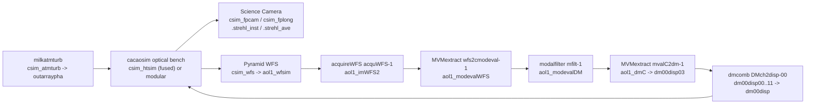

<!--
SPDX-FileCopyrightText: 2026 Olivier Guyon et al
SPDX-License-Identifier: LGPL-3.0-or-later
-->

# cacao-work

Integrated Adaptive Optics (AO) closed-loop testing workspace wiring four local checkouts into one
shared install prefix (`$MILK_INSTALL_ROOT`, typically `$MILK_SRC_DIR/_install/milk-<version>`):

- `milk` (`$MILK_SRC_DIR`, auto-detected at `../milk` or `~/src/milk`)
- `cacao` (`$CACAO_SRC_DIR`, auto-detected at `../cacao` or `~/src/cacao`)
- `cacaosim` (`$CACAOSIM_SRC_DIR`, auto-detected at `../cacaosim` or `~/src/cacaosim`)
- `AtmosphericTurbulenceSimul` / `milkatmturb` (`$ATMTURB_SRC_DIR`, auto-detected at
  `../AtmosphericTurbulenceSimul` or `~/src/AtmosphericTurbulenceSimul`, alongside
  `OpticsMaterials` and `WFpropagate`)

Override any checkout or install path in the environment before sourcing `env.sh` when using a
custom directory layout.

Every test and automated run isolates shared memory and process registries under
`/dev/shm/cacao_*` via `MILK_SHM_DIR` and `MILK_PROC_DIR`, sets `MILK_ROOT` and `CACAOSIM_WORKDIR`,
and leaves `/milk/shm` untouched.

## Optical & AO Control Architecture

Bench [`scao_pyr`](benches/scao_pyr/scao_pyr.bench) simulates an 8.0 m telescope at 400 Hz with
Gaussian-filtered Kolmogorov phase screens (`0.7"` seeing, `1024x1024` scrolling master screen), a
12x12 Shack/zonal-grid DM (`dm00disp`), a 64x64 4-sided Pyramid WFS (`csim_wfs`), and a 128x128
H-band (`1.65 um`) focal-plane Strehl camera (`csim_fpcam` / `csim_fplong`).

Bench orchestration uses the `fpspipe` / `cacaoloop` / `cacaosim.deploy` framework (`milk-script`,
`milk-fps-init/set/wait`, `milk-stream-link/wait/rm`, and `cacaosim-bench deploy/teardown`) without
any terminal multiplexer.



## Quickstart

```bash
source env.sh
./scripts/build-all.sh                   # build and install all local checkouts
pytest -v                                # run full isolated integration test suite
```

To verify installed binaries, shared libraries, and `commands.d` modules without recompiling:

```bash
./scripts/build-all.sh --check-only
```

## Workflows

### 1. Headless `fpspipe` + `.milk` Closed-Loop Validation (`run-scao-headless.sh`)

Runs the full sequence via `cacaosim-bench deploy` and
[`cacaoloop-scao-pyr.milk`](benches/scao_pyr/cacaoloop-scao-pyr.milk) (`deploy`, `calibrate`,
`close`, `zero`, `teardown --purge-dm`), using `milk-stream-wait` and `milk-fps-wait`:

```bash
source env.sh
./scripts/run-scao-headless.sh --mode fused --rate 400 --eval-frames 240 --save-rm _work/scao_pyr_rm
./scripts/run-scao-headless.sh --mode fused --rate 400 --eval-frames 240 --load-rm _work/scao_pyr_rm
./scripts/run-scao-headless.sh --mode modular --rate 400 --eval-frames 100
```

Passing `--save-rm <dir>` exports the calibrated Pyramid WFS response matrix (`zpokeC.fits`,
`zrespC.fits`, `HpokeC.fits`, `HrespC.fits`, standard CACAO `RMmodesDM.fits` / `RMmodesWFS.fits` /
`zrespM.fits` aliases, DM/WFS sensitivity maps and masks, `wfsref.fits`, `CMmodes*.fits`, and
`rm_meta.env`) so subsequent reruns with `--load-rm <dir>` skip Hadamard poking and recompute the
SVD control matrix directly.

You can also drive [`cacaoloop-scao-pyr.milk`](benches/scao_pyr/cacaoloop-scao-pyr.milk) directly
inside any initialized sandbox (use `-h1` or `-hm` for usage, including `save-rm` and `load-rm`):

```bash
./benches/scao_pyr/cacaoloop-scao-pyr.milk -hm
```

### 2. `fpspipe` Init + `cacao-aorun-*` Workflow (`run-scao-cacao-workflow.sh`)

Deploys the optical bench via `cacaosim-bench deploy`, initializes the AO workdir and FPS pipeline
with `cacaoloop-scao-pyr.milk deploy --init-only`, and runs native `cacao-aorun-000-dm`,
`025-acqWFS`, `026-takeref`, `020-mlat`, `cacao-mkDMpokemodes`, `030-acqlinResp`,
`031-RMHdecode`, `032-RMmkmask`, `039-compstrCM`, `050-wfs2cmval`, `060..063`, and `070-cmval2dm`:

```bash
source env.sh
./scripts/run-scao-cacao-workflow.sh --rate 400 --eval-frames 120
```

### 3. Persistent Interactive Live Bench (`live-bench.sh`)

Keeps the bench, turbulence, and optional calibrated AO loop alive using `cacaosim-bench deploy`
and `cacaoloop-scao-pyr.milk` for interactive inspection and tuning:

```bash
source env.sh
./scripts/live-bench.sh start --calibrate --close
eval "$(./scripts/live-bench.sh env)"
./scripts/live-bench.sh status
./scripts/live-bench.sh open
./scripts/live-bench.sh close 0.35
./scripts/live-bench.sh zero
./scripts/live-bench.sh turb 0.5
./scripts/live-bench.sh stop
```

### Interactive TUI Inspection

Once a live bench is running, connect directly to any milk/cacao/cacaosim TUI:

```bash
./scripts/live-bench.sh tui milk      # milk-CTRL (SHM streams)
./scripts/live-bench.sh tui fps       # milk-fpsCTRL (FPS units)
./scripts/live-bench.sh tui proc      # milk-procCTRL (process registry)
./scripts/live-bench.sh tui cacaosim  # cacaosim-CTRL (live optical bench DAG)
./scripts/live-bench.sh tui mstat     # cacao-modalstatsTUI 1 (modal telemetry)
```

Or connect manually in any shell with `eval "$(./scripts/live-bench.sh env)"`.

## Extending Benches & Tests

- Add new optical configurations under `benches/<bench_name>/` with a `<bench_name>.bench` plan and
  a `cacaoloop-<bench_name>.milk` (`milk-script`) controller using `fpspipe` and `cacaoloop`.
- Reuse `shm_sandbox` in `tests/conftest.py` for new pytest files under `tests/`. Keep all sandbox
  directories short to respect milk's 63-character `FPTYPE_FILENAME` limit, and keep all source
  and documentation lines within 100 characters.
