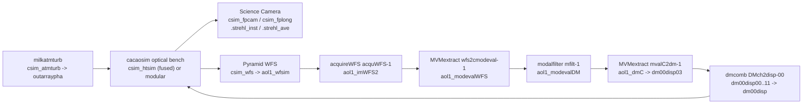

<!--
SPDX-FileCopyrightText: 2026 Olivier Guyon et al
SPDX-License-Identifier: LGPL-3.0-or-later
-->

# cacao-work

Open-source Adaptive Optics (AO) hardware-in-the-loop simulation, real-time control, and
benchmarking workspace wiring the complete MILK/CACAO ecosystem into one relocatable install
prefix (`$MILK_INSTALL_ROOT`, typically `$MILK_SRC_DIR/_install/milk-<version>`):

| Repository | Branch | Role in Simulation Stack |
| :--- | :---: | :--- |
| [cacao-work][r-cw] | `main` | Workspace, benches, pytest suite & web report publisher |
| [cacaosim][r-cs] | `main` | GPU polychromatic AO simulator, TUI & report engine |
| [cacao][r-ca] | `feat/bash-engine` | Real-time AO control (`mlat`, Hadamard RM, SVD CM) |
| [milk][r-mk] | `feat/bash-engine` | FPS SHM engine, `milk-script`, `streamFITSlog` & perf |
| [ImageStreamIO][r-is] | `dev` | POSIX/CUDA SHM stream transport (`milk` submodule) |
| [milk-mltools][r-ml] | `main` | Telemetry sync, `@calc` JIT, AO opt & PSF recon |
| [AtmosphericTurbulenceSimul][r-at] | `feat/bash-engine` | Maunakea turbulence (`milkatmturb`) |
| [OpticsMaterials][r-om] | `feat/bash-engine` | Material dispersion & air refractive index |
| [WFpropagate][r-wf] | `feat/bash-engine` | Fresnel & angular-spectrum wavefront propagation |

[r-cw]: https://github.com/cacao-org/cacao-work
[r-cs]: https://github.com/cacao-org/cacaosim
[r-ca]: https://github.com/cacao-org/cacao
[r-mk]: https://github.com/milk-org/milk
[r-is]: https://github.com/milk-org/ImageStreamIO
[r-ml]: https://github.com/milk-org/milk-mltools
[r-at]: https://github.com/oguyon/AtmosphericTurbulenceSimul
[r-om]: https://github.com/milk-org/OpticsMaterials
[r-wf]: https://github.com/milk-org/WFpropagate

Published live simulation reports & reproduction guide: <https://scexao-og.web.app/>

Override any checkout or install path in the environment before sourcing `env.sh` when using a
custom directory layout.

Every test and automated run isolates shared memory and process registries under
`/dev/shm/cacao_*` via `MILK_SHM_DIR` and `MILK_PROC_DIR`, sets `MILK_ROOT` and `CACAOSIM_WORKDIR`,
and leaves `/milk/shm` untouched.

## End-to-End Clone & Build (Clean Workspace / AI Agent Ready)

```bash
mkdir -p ~/src && cd ~/src
git clone -b feat/bash-engine https://github.com/milk-org/milk.git milk
git -C milk submodule update --init src/engine/ImageStreamIO
git clone -b feat/bash-engine https://github.com/cacao-org/cacao.git cacao
git clone -b main https://github.com/milk-org/milk-mltools.git milk-mltools
git clone -b feat/bash-engine https://github.com/milk-org/OpticsMaterials.git OpticsMaterials
git clone -b feat/bash-engine https://github.com/milk-org/WFpropagate.git WFpropagate
git clone -b feat/bash-engine \
    https://github.com/oguyon/AtmosphericTurbulenceSimul.git AtmosphericTurbulenceSimul
git clone -b main https://github.com/cacao-org/cacaosim.git cacaosim
git clone -b main https://github.com/cacao-org/cacao-work.git cacao-work

cd ~/src/cacao-work
source env.sh
./scripts/build-all.sh                   # configure, build & install all checkouts
pytest -v                                # run full isolated integration test suite
```

## Optical & AO Control Architecture

Bench [`scao_pyr`](benches/scao_pyr/scao_pyr.bench) simulates an 8.0 m telescope at 400 Hz with
Gaussian-filtered Kolmogorov phase screens (`0.7"` seeing, `1024x1024` scrolling master screen), a
12x12 Shack/zonal-grid DM (`dm00disp`), a 64x64 4-sided Pyramid WFS (`csim_wfs`), and a 128x128
H-band (`1.65 um`) focal-plane Strehl camera (`csim_fpcam` / `csim_fplong`).

Bench orchestration uses the `fpspipe` / `cacaoloop` / `cacaosim.deploy` framework (`milk-script`,
`milk-fps-init/set/wait`, `milk-stream-link/wait/rm`, and `cacaosim-bench deploy/teardown`) without
any terminal multiplexer.



## Quickstart

```bash
source env.sh
./scripts/build-all.sh                   # build and install all local checkouts
pytest -v                                # run full isolated integration test suite
```

To verify installed binaries, shared libraries, and `commands.d` modules without recompiling:

```bash
./scripts/build-all.sh --check-only
```

## Workflows

### 1. Headless `fpspipe` + `.milk` Closed-Loop Validation (`run-scao-headless.sh`)

Runs the full sequence via `cacaosim-bench deploy` and
[`cacaoloop-scao-pyr.milk`](benches/scao_pyr/cacaoloop-scao-pyr.milk) (`deploy`, `calibrate`,
`close`, `zero`, `teardown --purge-dm`), using `milk-stream-wait` and `milk-fps-wait`:

```bash
source env.sh
./scripts/run-scao-headless.sh --mode fused --rate 400 --eval-frames 240 --save-rm _work/scao_pyr_rm
./scripts/run-scao-headless.sh --mode fused --rate 400 --eval-frames 240 --load-rm _work/scao_pyr_rm
./scripts/run-scao-headless.sh --mode modular --rate 400 --eval-frames 100
```

Passing `--save-rm <dir>` exports the calibrated Pyramid WFS response matrix (`zpokeC.fits`,
`zrespC.fits`, `HpokeC.fits`, `HrespC.fits`, standard CACAO `RMmodesDM.fits` / `RMmodesWFS.fits` /
`zrespM.fits` aliases, DM/WFS sensitivity maps and masks, `wfsref.fits`, `CMmodes*.fits`, and
`rm_meta.env`) so subsequent reruns with `--load-rm <dir>` skip Hadamard poking and recompute the
SVD control matrix directly.

You can also drive [`cacaoloop-scao-pyr.milk`](benches/scao_pyr/cacaoloop-scao-pyr.milk) directly
inside any initialized sandbox (use `-h1` or `-hm` for usage, including `save-rm` and `load-rm`):

```bash
./benches/scao_pyr/cacaoloop-scao-pyr.milk -hm
```

### 2. `fpspipe` Init + `cacao-aorun-*` Workflow (`run-scao-cacao-workflow.sh`)

Deploys the optical bench via `cacaosim-bench deploy`, initializes the AO workdir and FPS pipeline
with `cacaoloop-scao-pyr.milk deploy --init-only`, and runs native `cacao-aorun-000-dm`,
`025-acqWFS`, `026-takeref`, `020-mlat`, `cacao-mkDMpokemodes`, `030-acqlinResp`,
`031-RMHdecode`, `032-RMmkmask`, `039-compstrCM`, `050-wfs2cmval`, `060..063`, and `070-cmval2dm`:

```bash
source env.sh
./scripts/run-scao-cacao-workflow.sh --rate 400 --eval-frames 120
```

### 3. Persistent Interactive Live Bench (`live-bench.sh`)

Keeps the bench, turbulence, and optional calibrated AO loop alive using `cacaosim-bench deploy`
and `cacaoloop-scao-pyr.milk` for interactive inspection and tuning:

```bash
source env.sh
./scripts/live-bench.sh start --calibrate --close
eval "$(./scripts/live-bench.sh env)"
./scripts/live-bench.sh status
./scripts/live-bench.sh open
./scripts/live-bench.sh close 0.35
./scripts/live-bench.sh zero
./scripts/live-bench.sh turb 0.5
./scripts/live-bench.sh stop
```

### Interactive TUI Inspection

Once a live bench is running, connect directly to any milk/cacao/cacaosim TUI:

```bash
./scripts/live-bench.sh tui milk      # milk-CTRL (SHM streams)
./scripts/live-bench.sh tui fps       # milk-fpsCTRL (FPS units)
./scripts/live-bench.sh tui proc      # milk-procCTRL (process registry)
./scripts/live-bench.sh tui cacaosim  # cacaosim-CTRL (live optical bench DAG)
./scripts/live-bench.sh tui mstat     # cacao-modalstatsTUI 1 (modal telemetry)
```

Or connect manually in any shell with `eval "$(./scripts/live-bench.sh env)"`.

### 4. Cascaded Subaru AO3k + SCExAO + Lyot Coronagraph & LLOWFS (`run-ao3k-scexao.sh`)

Bench [`ao3k_scexao`](benches/ao3k_scexao/ao3k_scexao.bench) and controller
[`cacaoloop-ao3k-scexao.milk`](benches/ao3k_scexao/cacaoloop-ao3k-scexao.milk) model the Subaru
Nasmyth-IR (`7.95 m`, `cobs = 30.7%`, off-center `51.75 deg` V-spiders, `20%` optical throughput)
multi-stage AO and coronagraphic system (`8.0 kHz` / `125 us` sub-stepping):

- Stage 1 (`ao3k`, `aol1`): 64x64 DM (`dm01disp`, D=60) + 160x160 J-band (1.22 um, 20% BW) PyWFS
  at 1.0 kHz
- Stage 2 (`scexao`, `aol2`): 50x50 DM (`dm02disp`, D=46) + 120x120 Vis (0.75 um, 20% BW) PyWFS
  at 2.0 kHz with real-time zero-point offset (`zpo-2`: `aol2_dmzpo -> aol2_wfszpo`)
- Stage 3 (`llowfs`, `aol3`): 14 low-order Zernike modes (`Z2..Z15`) on `dm02disp04`, driven at
  500 Hz by a 64x64 H-band defocused (`+200 nm` RMS `Z4`) camera fed by light reflected off the
  coronagraph pupil-plane Lyot stop (`lowfs_mode = "lyot_refl"`)
- Simultaneous polychromatic Visible (0.75 um, 15% BW) and H-band (1.65 um, 18% BW) PSFs at Raw,
  Stage-1, Final unocculted, and post-Lyot coronagraphic (`3.0 lambda/D` spot) focal planes

```bash
source env.sh
./scripts/run-ao3k-scexao.sh --phys-time 2.0 --save-rm _work/ao3k_scexao_rm
./scripts/run-ao3k-scexao.sh --phys-time 10.0 --load-rm _work/ao3k_scexao_rm
./scripts/run-ao3k-scexao.sh --phys-time 10.0 --load-rm _work/ao3k_scexao_rm \
    --predictive --calib-2wfs1dm --save-telemetry speckle
```

Outputs (integrated FITS PSFs, wavefront stats, metrics JSON, diagnostic plots, and `REPORT.md` /
`COMPUTE_REPORT.md`) are written under `_work/ao3k_scexao` (or `--outdir`). Passing
`--save-telemetry [standard|speckle|truth]` flushes paired `.fits`/`.txt` cubes into
`_work/ao3k_scexao/telemetry` (`speckle` also records 2.0 kHz Stage-1/Final science PSFs and renders
`wfs_psf_short_evolution.mp4`), and runs `milk-mlt-aotlm` (`mlt.aoopt` + `mlt.psfrecon`) to
generate `_work/ao3k_scexao/telemetry/analysis/TELEMETRY_REPORT.md`. Passing `--calib-2wfs1dm`
activates post-loop 2-WFS + inter-stage DM telemetry calibration (`milk-mlt-calib2wfs1dm` /
`mlt.sysid`) to solve `B = Mab A + Mdb D + b0` and virtual upstream `A = Mba B - Mda_virt D + a0`,
rendering `calib_2wfs1dm_summary_2x2.png` and its full section in `REPORT.md`.

#### Publishing Reports to Firebase Hosting

Build static HTML pages (Front Page with GitHub provenance & CLI/AI reproduction guide,
`REPORT.md`, `COMPUTE_REPORT.md`, diagnostic PNGs/MP4, and JSON/CSV telemetry) under
`_work/_web_site` and publish publicly under a Firebase-enabled GCP project:

```bash
./scripts/publish-ao-report.sh --build-only
./scripts/publish-ao-report.sh --project <gcp-project>
```

## Extending Benches & Tests

- Add new optical configurations under `benches/<bench_name>/` with a `<bench_name>.bench` plan and
  a `cacaoloop-<bench_name>.milk` (`milk-script`) controller using `fpspipe` and `cacaoloop`.
- Reuse `shm_sandbox` in `tests/conftest.py` for new pytest files under `tests/`. Keep all sandbox
  directories short to respect milk's 63-character `FPTYPE_FILENAME` limit, and keep all source
  and documentation lines within 100 characters.
