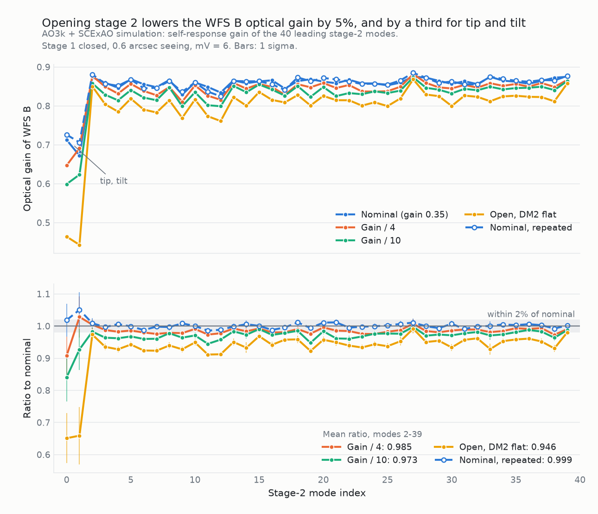

# WFS B optical gain versus the state of the stage-2 loop

> Moved here from `_work/`. Run data are not in git: `R` in the commands below is where
> they were on the original machine. See `../README.md`.

AO3k + SCExAO two-stage simulation, 2026-11-19. Question: does the optical gain of WFS B
(the SCExAO visible pyramid) stay the same when the stage-2 loop is opened or run at reduced
gain? It decides whether a two-step calibration may hold the WFS-A-to-WFS-B relation `Mab`
fixed between a stage-2-open step and a stage-2-closed step.

## Verdict

**No.** With stage 2 open the WFS B optical gain is not within 2% of its closed-loop value:
it is 5.4% lower for modes 2-39 and about 35% lower for tip and tilt.

At one quarter of the nominal gain it is 1.6% lower (inside 2%, tip and tilt not resolved);
at one tenth it is 2.7% lower.

## Result

Stage 1 closed in every state; 0.6 arcsec seeing; mV = 6; integrator control; LLOWFS open.
Stage-2 leak multiplier (`--mult2`, `mfilt-2.loopmult`): **0.98** in every state.

| Stage-2 state | Gain | WFS B gain | Ratio, modes 2-39 | Tip/tilt ratio | Strehl | Residual |
| :--- | ---: | :---: | :---: | :---: | :---: | :---: |
| Nominal | 0.35 | 0.861 | 1 | 1 | 0.74 | 50 / 64 nm |
| Gain / 4 | 0.0875 | 0.849 | 0.985 ± 0.001 | 0.96 ± 0.04 | 0.49 | 56 / 117 nm |
| Gain / 10 | 0.035 | 0.840 | 0.973 ± 0.001 | 0.89 ± 0.05 | 0.48 | 60 / 133 nm |
| Open, DM2 flat | 0 | 0.815 | 0.946 ± 0.001 | 0.65 ± 0.06 | 0.42 | 73 / 140 nm |
| Nominal, repeated | 0.35 | 0.863 | 0.999 ± 0.001 | 1.03 ± 0.04 | 0.74 | 52 / 67 nm |

- **WFS B gain**: median over the 40 leading stage-2 modes of the self-response gain.
- **Ratio**: gain divided by the nominal-state gain, mode by mode; error-weighted mean and its
  1-sigma error. The repeat of the nominal state, taken last, shows the reproducibility.
- **Strehl**: mean Strehl at 0.75 um (10 ms exposures) of the beam that reaches WFS B.
- **Residual**: RMS optical path difference at WFS B from 5 snapshots per state, with the piston
  of each pupil segment removed / with its fractional-wave part at 0.75 um kept (see Limits).

Trend with mode index (median ratio per group; spread over modes 2-39):

| Stage-2 state | 0-1 | 2-9 | 10-19 | 20-29 | 30-39 | Quartiles | Min to max |
| :--- | :---: | :---: | :---: | :---: | :---: | :---: | :---: |
| Gain / 4 | 0.97 | 0.981 | 0.982 | 0.984 | 0.989 | 0.980 to 0.991 | 0.973 to 1.007 |
| Gain / 10 | 0.88 | 0.964 | 0.973 | 0.975 | 0.979 | 0.964 to 0.981 | 0.945 to 0.998 |
| Open, DM2 flat | 0.65 | 0.932 | 0.945 | 0.950 | 0.955 | 0.933 to 0.957 | 0.911 to 0.992 |
| Nominal, repeated | 1.03 | 0.999 | 0.997 | 1.001 | 1.002 | 0.996 to 1.006 | 0.986 to 1.012 |

The loss is largest for the lowest modes and shrinks slowly with mode index (+0.010 per 10
modes in the open state).



Consequence for the two-step calibration, using the toy-model result that a fixed `Mab`
returns the WFS B gain of the step in which `Mab` was measured: a stage-2-open first step
would make `Mdb` read about 5% low for modes 2-39 and about a third low for tip and tilt.
A first step at a quarter of the nominal gain would cost under 2% for modes 2-39.

## How it was measured

Optical gain of mode `m` = response of WFS B mode `m` to a poke of DM2 mode `m` with turbulence
and loops running, divided by the same response without turbulence. Both come from the
self-response cubes of `mfilt-2` (`--ampl 0.020 --nbiter 16 --nbsettle 6`, 8 lags, 40 modes;
calibration cube from the stock step 4b). Three estimators were computed:

- `peak` (as `milk-mlt-calib2wfs1dm` writes `og_selfrm.fits`): maximum over lags.
- `slice` (as `load_selfrm_og` in `scripts/build-calib-2wfs1dm-report.py`): one lag per cube.
- `fixed` (used above): lag 4 minus the mean of lags 0-2, for every state. Lag 4 is the first
  fully risen lag and precedes any loop reaction; lags 0-2 precede the response and remove the
  slow-drift error that the +/- poke pairs leave, which matters for low modes with stage 2 open.

The three agree on the median ratio: `peak` 0.985 / 0.971 / 0.952, `slice` 0.985 / 0.971 /
0.949, `fixed` 0.985 / 0.973 / 0.943 (all 40 modes). `peak` is biased high in the open state
because it takes a maximum over four equal noisy lags.

Per-mode errors are the RMS of the same quantity over the other poked modes (same noise, no
signal): 0.004 to 0.007 for modes 2-39 (median per state), 0.02 to 0.06 for tip and tilt.

## Checks

- **No dropped frames.** The turbulence and WFS B frame counters agree to within one count in
  all ten windows (about 8000 ticks for statistics, 19217 for self-response), and WFS A has
  half as many.
- **Reproducible.** The nominal state measured again at the end of the scan gives
  0.999 ± 0.001.
- **No loop-gain artefact.** The rise of the response (lag 3 / lag 4) is 0.883 to 0.885 in all
  five measurements and 0.881 in calibration, so the loop has not started to react at lag 4.
- **Open really is open.** With DM2 flat the Strehl after stage 2 equals the Strehl after
  stage 1 (0.419 and 0.419).

## Choices made, and why

1. **One session instead of four stock runs.** This laptop GPU (RTX A5500) cannot hold the
   stock pacing. A first stock run at 360 Hz processed 7987 optics frames for 16979 turbulence
   ticks, so it was discarded. At a pacing that holds (50 Hz, 0.025x real time) four stock runs
   would take about three hours, so `run-og-states.sh` runs the stock `sim-ao3k-scexao.milk`
   unchanged up to loop closure (deploy, calibrate, close) and then scans the states under
   that single calibration (`og-states-tail.part`).
2. **LLOWFS open in all states**, so that the stage-2 gain is the only thing that changes.
3. **"Open" is loop off with DM2 flat.** The bench has no static aberration in the common
   path, so flat is the mean closed-loop shape.
4. **No WFS A cross-check.** The stage-1 calibration self-response cube came out almost empty
   on this machine, in the discarded stock run and in the scan (a handful of non-zero elements
   in the 40 x 40 block), so the WFS A gain could not be compared between stage-2 states.
   I did not find out why; the stage-2 cube from the same step is clean.
5. **Build.** The `milk` build on this machine predates the `milk-mltools` plugin. I linked it
   into `milk/plugins/` (ignored by git, as `build-all.sh` does on a first configure),
   re-ran the configure step and ran `./scripts/build-all.sh`. Check: 74 binaries, 13
   libraries, 5 command modules.

## Limits

- One seeing value, one star brightness, one turbulence sequence: 4 s of statistics and 9.6 s
  of self-response per state.
- Timing is this machine's. The stage-1 control computation takes 10 ms per frame (13 ms at
  the 99th percentile) against a 20.5 ms tick, so its command lands before the next optics
  tick in the typical frame and at the boundary in the slowest ones. The nominal Strehl
  (0.74 at 0.75 um) is therefore not necessarily the reference machine's.
- Tip and tilt are the least certain numbers (two modes, ratio errors of 0.05 to 0.09 each).
- The simulator leaves piston steps between the four pupil segments. Stage 2 locks them to
  whole waves at 0.75 um, which WFS B cannot see; stage 1 locks them at 1.22 um, so the beam
  that reaches WFS B with stage 2 open carries fractional-wave steps. That is why the two
  residual figures differ so much in the open state. I did not check how well this represents
  the real AO3k beam; it probably contributes to the large tip and tilt loss.
- The raw wavefront RMS written by the simulator (`wf_stats.json`, about 1000 nm) is
  dominated by those whole-wave steps and is not a residual that either sensor sees.

## Commands

```bash
cd "$(git rev-parse --show-toplevel)"
ln -s "$(realpath ../milk-mltools)" ../milk/plugins/milk-mltools-src
source env.sh
cmake -S "$MILK_SRC_DIR" -B "$MILK_SRC_DIR/_build"
./scripts/build-all.sh --jobs 20
./scripts/build-all.sh --check-only

cd algo/calib2wfs1dm/og_vs_stage2_state
R="$(git rev-parse --show-toplevel)/_work/og_vs_stage2_state"
OGS_STATES="a_nominal:0.35,c_quarter:0.0875,d_tenth:0.035,b_open:open,a_repeat:0.35" \
OGS_SRM_ITER=16 OGS_WF_TICKS=8000 OGS_SETTLE_TICKS=4000 \
./run-og-states.sh --seeing 0.6 --wall-rate 50 --calib-rate 100 --no-lowfs --gain2 0.35 \
    --selfrm-modes 40 --save-rm "$R/scan50/rm" --outdir "$R/scan50" > $R/scan50.log 2>&1

python3 reduce.py $R/scan50 a_nominal > reduce_output.txt
python3 plot.py $R/scan50 "a_nominal=Nominal (gain 0.35)" "c_quarter=Gain / 4" \
    "d_tenth=Gain / 10" "b_open=Open, DM2 flat" "a_repeat=Nominal, repeated"
```

`reduce.py` and `plot.py` write `og_vs_stage2_state.json` and `.png` into the scan directory;
the copies here were taken from there. The scan takes 55 minutes on the original machine.
Every run used its own `/dev/shm/cacao_work_ogs_<pid>` sandbox, removed on exit.

## Files

| File | Content |
| :--- | :--- |
| `og_vs_stage2_state.json` | per-mode gains, errors, ratios, Strehl and residuals per state |
| `og_vs_stage2_state.png` | the figure above |
| `reduce_output.txt` | full text output of the reduction |
| `og_states_counts.csv` | frame counters and Strehl per state and window |
| `run-og-states.sh`, `og-states-tail.part` | sandbox wrapper and the custom scan tail |
| `reduce.py`, `plot.py` | reduction and figure |

The scan directory (`scan50/`: calibration and per-state cubes, statistics, response matrices,
2.7 GB) and the logs are not in git.

Source state: `cacao-work` dd8b0b7, `milk` 8bbd34164, `cacao` 6e70dd00, `cacaosim` 35c0aba,
`milk-mltools` 50405f6, `AtmosphericTurbulenceSimul` 3ab9e99. `milk`, `cacao`, `cacaosim` and
the turbulence repository had uncommitted local changes, which the build includes.
