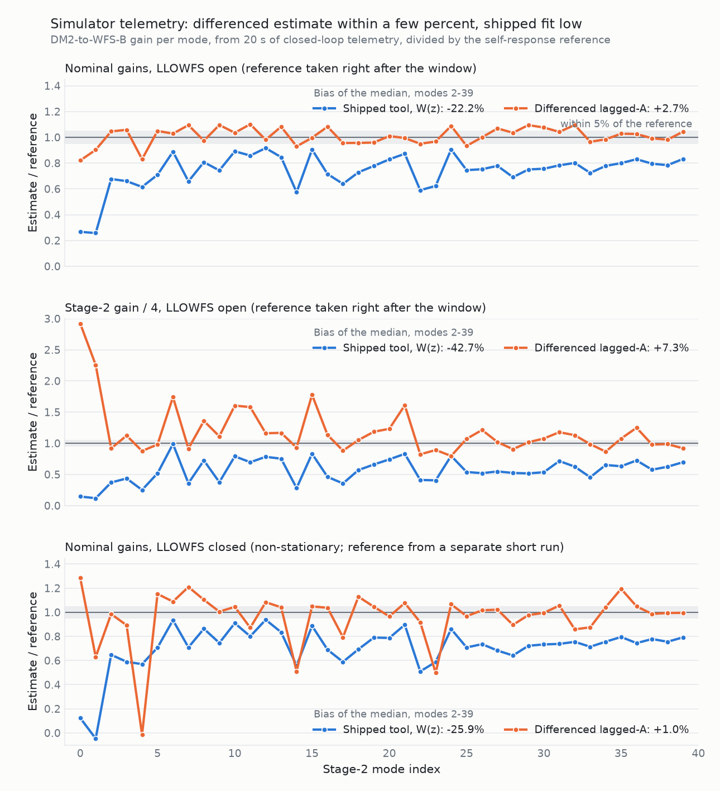
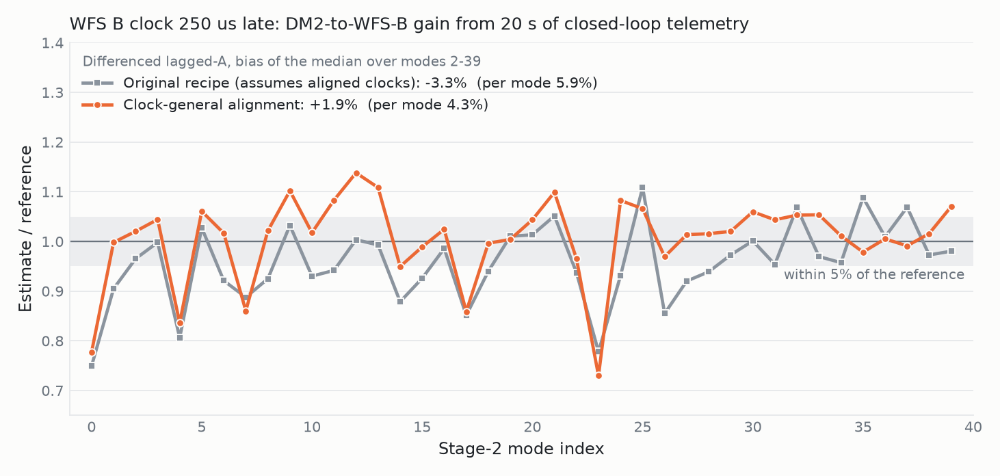

# Differenced lagged-A estimator on real simulator telemetry

> Moved here from `_work/`. Run data are not in git: `R` in the commands below is where
> they were on the original machine. See `../README.md`.

AO3k + SCExAO two-stage simulation, 2026-11-20. Until now the estimator recommended for the
2-WFS + 1-DM calibration had only been run on a toy model. This is its first run on telemetry
from the real simulator, against a gain reference measured by probing.

## Verdict

**It works.** With both loops closed at their nominal gains, the differenced lagged-A estimate
of the DM2-to-WFS-B gain is 2.7% above the probed reference (median over modes 2-39, 20 s of
telemetry), with a per-mode median error of 4.4%. On the same data the shipped `W(z)` fit reads
22% low and plain least squares 92% low.

Tip and tilt are not recovered (18% and 10% low), and the LLOWFS-closed case could only be
checked loosely (see below).

The alignment step has since been rewritten so that it does not depend on the two frame
clocks. It gives the same numbers on this data and +1.9% on a run with the WFS B clock shifted
by 250 us, where the original recipe reads -3.3%. See "Arbitrary frame clocks".

## Result

0.6 arcsec seeing, mV = 6, integrator control, 20 s windows. Bias of the median over modes
2-39, with the per-mode median error in parentheses.

| Window | Reference | Shipped `W(z)` | LS | LS, diff. | Lagged-A | Differenced lagged-A |
| :--- | :---: | :---: | :---: | :---: | :---: | :---: |
| Nominal gains, LLOWFS open | 0.860 | -22% | -92% | +48% | -2% (6%) | **+2.7% (4.4%)** |
| Stage-2 gain / 4, LLOWFS open | 0.841 | -43% | -83% | +77% | -21% (21%) | +7.3% (12%) |
| Nominal gains, LLOWFS closed | 0.828 * | -26% | -103% | +48% | -21% (21%) | +1.0% (6%) |

LS = least squares of `B` on `(psi, D)`; "diff." = on first differences.

\* Reference from a separate short run; this window is not stationary. See "LLOWFS closed".



**Reference.** The response of WFS B mode `i` to a step of DM2 mode `i` with the loops running,
from the stage-2 self-response cube taken right after each window (lag 4 minus lags 0-2).
In the nominal LLOWFS-open window it is confirmed twice over by quantities that do not use the
poke plateau: the gain with which the loop's own reaction acts inside the same cube
(0.850 against 0.860), and a probe-as-instrument fit on logged pokes in a second run (0.862).
At gain / 4 the loop-reaction check gives 0.795 against 0.841; the reaction is small at that
gain, so the check is weaker there.

**Estimator**, exactly as specified from the toy before any real data was looked at:

1. `D_eff[k] = 0.883 D[k-2] + 0.117 D[k-3]`: the DM2 command as it acts during WFS B frame
   `k`. The weights are the rise of the self-response (lag 3 / lag 4).
2. Each WFS A frame is paired with the two WFS B frames of its own exposure: the last WFS B
   frame written before it and the one before that. `B` and `D_eff` are averaged over them.
   (This is the original recipe. It is the special case of the clock-general alignment below
   for a 1 kHz / 2 kHz pair with aligned clocks.)
3. `psi = A Mab0`, with `Mab0` a ridge fit of `B - g_start D_eff` on the 60 leading WFS A modes.
4. First differences of `B`, `psi`, `D_eff`; per mode, two-stage least squares of `dB` on
   `(dpsi, dD)` with `dpsi` at lags 2 to 9 as instruments.

## What the toy predicted, and what the simulator did

| Toy prediction | Real telemetry |
| :--- | :--- |
| Least squares returns the inverse controller, near -100% | -92% |
| Differencing without instruments overshoots | +48% |
| Lag 1 is not a valid instrument after differencing | lags 1-8 give +60% |
| Exposure matching must be exact | shifting the pairing by one tick gives -11% or +33% |
| The estimate does not remember its starting gain | +1.9 / +2.8 / +2.9% from 0.5x / 1x / 1.5x |
| The undifferenced form is fragile | -2% in the median, but six modes 40 to 84% low |
| A lower stage-2 gain hurts when the leak is 0.98 | +7.3% and three times the scatter |
| Usable part of the DM2 motion about 18% | 15% |
| Per-mode error 2-3% in 20 s | 4.4% |

## Checks

- **Frame association is exact.** Stream counters are consecutive (no dropped frames), and the
  logged DM2 command obeys `D[k] = 0.98 D[k-1] - gain B[k]` with correlation -1.0000 at zero
  shift and a fitted gain of 0.346.
- **Repeatable.** Two 10 s halves give +2.4% and +1.9%. Four 5 s quarters give +2.3, +0.9, +5.5
  and +6.0% (per-mode error 6 to 10%).
- **Not sensitive to the fixed choices.** Instruments at lags 2-17: +0.7% (2.8% per mode);
  lags 3-10: +2.1%; lags 2-5: +4.5%; `Mab0` ridge 10x smaller or larger: +2.7 / +2.3%;
  40 or 100 WFS A modes: +3.2 / +1.7%. Lags 2-3 alone are too weak (48% per-mode error).
- **Timing kernel.** Putting all the DM2 weight at lag 2 moves the result to -1.1%; the value
  used is measured, not fitted.
- **Per-mode errors are mostly noise.** They correlate only 0.20 between the two halves.

## Arbitrary frame clocks

The recipe above only fits this bench as configured: WFS A at 1 kHz, WFS B at 2 kHz, frames
ending together. The alignment in `realsim_est.py` now works from the time each exposure ends,
for any two frame clocks. Only that step changed; the estimator is the same.

**It reproduces the earlier results exactly, and it works with offset clocks.** On a new run
with the WFS B clock 250 us late (a quarter of a WFS A frame), it reads +1.9% against the
probed reference (4.3% per mode). The original recipe reads -3.3% (5.9% per mode) on the same
telemetry. Frame rates other than 1 kHz / 2 kHz were tested on the toy model only.



### The alignment

1. `D_eff[k]` as before: the DM2 command as it acts during WFS B frame `k`, with the weights
   of the measured step response.
2. The common timeline is made of windows of whole WFS B frames, so `B` and `D_eff` are plain
   means and need no sub-frame model. Window length:
   - the shortest run holding two frames of each sensor. Window edges cut WFS A frames;
     instruments start at lag 3, because a cut frame puts its noise in two windows.
   - unless a run no longer than that, of at least two WFS B frames and one WFS A frame, has
     all its edges on WFS A frame edges: then the shortest such run. No WFS A frame is cut;
     instruments start at lag 2.
3. `A` over a window is the mean of the WFS A frames it overlaps, weighted by the overlap.

For this bench with aligned clocks rule 2 returns the original recipe (two WFS B frames, one
WFS A frame). With the 250 us offset it returns four WFS B frames (2 ms).

The exposure times come from `sim_frame_times()`, the only simulator-specific part: frame
counters, the two frame periods and the configured WFS B clock offset. A real system would
pass hardware timestamps to `align_frames()` instead.

### Results

Differenced lagged-A, bias of the median over modes 2-39 (per-mode median error), 20 s.

| Telemetry | Alignment | Window | Result |
| :--- | :--- | :---: | :---: |
| Aligned clocks (`run1`, nominal) | original recipe | 1 ms | +2.7% (4.4%) |
| same | clock-general | 1 ms | +2.7% (4.4%) |
| same, windows moved to cut WFS A frames in half | clock-general | 2 ms | +2.2%, +3.2% (4.4%) |
| WFS B clock 250 us late (`run3`) | original recipe | 1 ms | -3.3% (5.9%) |
| same | clock-general | 2 ms | **+1.9% (4.3%)** |

On `run3` the other three ways of placing the 2 ms windows give +2.9, +3.0 and +2.9%.
`run3` reference: 0.854 (loop-reaction check 0.827); shipped `W(z)` -19%, least squares -86%.

Toy prediction for the same offset: original recipe 8 points below the aligned-clock value,
clock-general alignment 1 point above. Measured: 6 points below, 1 point below.

### Checks

- **Nothing changed on the existing data.** Same samples (`B` and `D_eff` bit-identical, `A`
  equal to 3e-12 of its rms) and per-mode results of every estimator equal to 1e-12, on all
  three `run1` windows.
- **The offset run is sound.** No dropped frames (40201 = 40201); controller law correlation
  -1.0000, gain 0.346; response matrices equal to those of `run1` (correlation 1.0000).
- **The clock offset is visible in the telemetry.** The cross-spectrum phase between the
  WFS A and WFS B views of the incoming wavefront puts the `run3` exposures 259 +- 3 us from
  where they are in `run1` (configured: 250 us). Two aligned-clock windows differ by
  -5 +- 4 us. (`clock_check.py`)
- **The offset has to be known to a few tens of microseconds.** Telling the alignment 125 or
  375 us instead of 250 us gives +5.3% and -2.0%.
- **The DM2 timing has to be re-measured.** With the offset, the simulator applies a DM2
  command 250 us later after the WFS B exposure: the rise of the step response goes from
  0.883 to 0.386 (0.382 expected if the command waits for the next 2 kHz tick). Keeping 0.883
  gives +15.8%.
- **No memory of the starting gain.** +0.8 / +2.4 / +2.9% from 0.5x / 1x / 1.5x the reference.
- **Repeatable.** Halves +1.9 and +4.4%; quarters -0.3, +0.1, +2.9 and +3.7%.
- **First instrument lag.** With cut frames, lag 2 instead of 3 gives +2.4% (4.7%) on `run3`
  and +4.8% (6.3%) against +2.2% (4.5%) on `run1`. Lag 4 gives -16%: too old.

### How long a window

Same telemetry and reference, only the window length changes (`window_checks.py`). Windows
that cut WFS A frames; one value per way of placing the windows.

| WFS B frames per window | `run1`, frames cut in half | `run3`, clock offset | Usable DM2 motion |
| :---: | :---: | :---: | :---: |
| 2 (one WFS A frame) | +14.2% | +8.6, +6.0% | 17-21% |
| 3 | +2.4, +2.4, +3.7% | +4.4, +3.8, +3.8% | 17-22% |
| 4 (the rule) | +3.2, +2.2% | +1.9, +2.9, +3.0, +2.9% | 11-19% |
| 5 | -5.4, -8.2% | -2.8, -3.6% | 3-5% |
| 6 | -23.9% | -24.0, -21.3% | 1% |
| 8 | -21.5% | -11.1, -11.9% | 1-2% |

When frames are cut the window can be neither shorter nor longer than about two WFS A frames.
Shorter, the cut frames weigh too much. Longer, the first usable instrument is more than about
six WFS A frames old and no longer carries DM2 motion that the WFS A signal does not explain;
the estimate then collapses. `realsim_est.py` prints this "usable" fraction and flags it below
5%. Windows that cut no frame tolerate more: 4, 6 and 8 WFS B frames on `run1` give -0.2 / -2.0,
-2.3 and -7.0%.

Two variants were tried and not made the default:

- **Linear inside cut frames** (`--linear`) instead of constant: -0.1 to +1.5% (3.4% per
  mode) on `run3`, -0.4 and -1.6% on `run1`. Slightly better or equal in the toy, not
  clearly so here.
- **Instruments taken frame by frame**: the 8 most recent single-frame differences of `psi`
  whose WFS A frames touch neither window. Identical to the recipe when a window is one
  WFS A frame. It removes the collapse (windows of 3 to 8 frames stay between 0 and +6.5% on
  both runs), but at the rule's window it reads 1 to 3 points higher than the default.

### Other frame rates (toy model only)

The bench runs at 1 kHz / 2 kHz, so other rates could not be tested on the simulator. Toy
model, 20 s, 12 runs per case, the rule above (`freq_scan5.py`).

| WFS A / WFS B | Window | Bias (per mode) |
| :--- | :---: | :---: |
| 1 kHz / 2 kHz | 2 B | -0.1% (1.8%) |
| 1 kHz / 3 kHz | 3 B | +0.3% (2.2%) |
| 500 Hz / 2 kHz | 4 B | +0.0% (3.8%) |
| 2 kHz / 1 kHz | 2 B | +0.7% (3.5%) |
| 1 kHz / 1 kHz | 2 B | +0.3% (3.1%) |
| 1 kHz / 1 kHz, offset 1/4 frame | 2 B, cut | +2.9% (3.7%) |
| 1 kHz / 1 kHz, offset 1/2 frame | 2 B, cut | +2.5% (3.5%) |
| 1 kHz / 2 kHz, offset 1/4 A frame (as `run3`) | 4 B, cut | +0.8% (1.7%) |
| 1 kHz / 1.5 kHz | 3 B | +0.1% (1.6%) |
| 1 kHz / 1.846 kHz | 4 B, cut | +0.3% (1.7%) |
| 1 kHz / 1.2 kHz | 3 B, cut | +0.6% (2.0%) |
| 1.2 kHz / 1 kHz | 2 B, cut | +1.9% (4.0%) |
| 1.846 kHz / 1 kHz | 2 B, cut | -0.0% (3.4%) |
| 1 kHz / 2.182 kHz, offset | 5 B, cut | +0.4% (1.9%) |
| 500 Hz / 2 kHz, offset 1/8 A frame | 8 B, cut | **-4.2% (8.1%)** |
| 500 Hz / 1 kHz, offset 1/4 A frame | 4 B, cut | +0.0% (3.9%) |
| 500 Hz / 1.2 kHz | 5 B, cut | -0.3% (4.5%) |
| 2 kHz / 1 kHz, offset 1/2 A frame | 2 B, cut | -0.7% (3.1%) |

Seventeen cases are within 3%. The exception is a slow WFS A with a fast WFS B and offset
clocks: the window is 4 ms, the usable fraction 1.5%, and the 5% flag would fire. The
frame-by-frame instruments do better there (+2.8%, 5.0% per mode) but are noisier when the two
rates are equal or close (per-mode error 5 to 9% against 3 to 4%); neither set wins
everywhere.

### Limits

- Other frame rates and drifting clocks: toy model only.
- The exposure times are taken from the simulator's clock model. The telemetry check of the
  offset is differential: it needs a window recorded with aligned clocks.
- The calibration self-response cube was corrupted again in `run3` (zero diagonal), so the
  DM2 timing weight comes from the on-sky cube, as in `run1`.

## LLOWFS closed: no clean test

With the stage-3 loop closed, the simulation on this machine falls into bursts a few seconds
after closure (stage-2 tip/tilt residual alternates between about 2 and 12 in units of 1e-3).
The self-response reference taken after 20 s in that state was not usable: the poke plateau
read 0.33 while the loop's own reaction in the same cube read 0.69.

A separate short run, measured 2.5 to 4.9 s after closing the LLOWFS loop, is self-consistent:
plateau 0.828, loop reaction 0.820, probe-as-instrument 0.842. Against that reference the
20 s window gives +1.0% (4 s sub-windows range from 0.79 to 0.90 in absolute gain). That is
consistent but it is not a simultaneous reference, so I count this case as not tested.

Adding the logged stage-3 DM command as regressors did not change the result (0.83 to 0.84).
Its own coefficient sums to -0.25, the value expected for `g - g_zpo` if the zero-point offset
acts with unit gain.

## Problems found in passing

1. **A self-response reference can be badly wrong when the LLOWFS loop is closed.** The
   published study's main runs had it closed. Check them with `selfrm_dyn.py`: if the poke
   plateau and the loop-reaction gain disagree, the reference is not valid.
2. **The calibration self-response cube is unreliable on this machine** (fast lockstep mode).
   In this run the stage-2 cube was corrupted (plateau 0.5 to 0.6 instead of 1.0), so the
   shipped `og_selfrm.fits` is not reliable here. The stage-1 cube was almost empty in every
   run. This comparison does not use the calibration cube.

## Not tested

- Predictive control, other seeing or star brightness, tip and tilt.
- `Mda_virt`: there is no reference for it in this setup.
- Anything outside the simulator.

## Commands

```bash
cd algo/calib2wfs1dm/realsim
R="$(git rev-parse --show-toplevel)/_work/calib_2wfs1dm_realsim"

TLW_WINDOWS="lowfs_open:0:40000,lowfs_closed:1:40000,gain_quarter:0:40000:0.0875" \
TLW_SRM_ITER=16 TLW_SETTLE_TICKS=4000 \
./run-tlm.sh --seeing 0.6 --wall-rate 50 --calib-rate 100 --no-lowfs --gain2 0.35 \
    --selfrm-modes 40 --save-rm "$R/run1/rm" --outdir "$R/run1" > $R/run1.log 2>&1

TLW_WINDOWS="dbg_open:0:6600,dbg_closed:1:6600" TLW_SRM_ITER=4 TLW_SETTLE_TICKS=4000 \
TLW_LOG_SRM=1 ./run-tlm.sh --seeing 0.6 --wall-rate 50 --calib-rate 100 --no-lowfs \
    --gain2 0.35 --selfrm-modes 40 --load-rm "$R/run1/rm" --save-rm "$R/run2/rm" \
    --outdir "$R/run2" > $R/run2.log 2>&1

TLW_WINDOWS="skew_open:0:40000" TLW_SRM_ITER=16 TLW_SETTLE_TICKS=4000 \
./run-tlm.sh --seeing 0.6 --wall-rate 50 --calib-rate 100 --no-lowfs --gain2 0.35 \
    --selfrm-modes 40 --clock-skew-us 250 --save-rm "$R/run3/rm" --outdir "$R/run3" \
    > $R/run3.log 2>&1

python3 realsim_est.py $R/run1 lowfs_open
python3 realsim_est.py $R/run1 gain_quarter
python3 realsim_est.py $R/run1 lowfs_closed --ref-from $R/run2:dbg_closed
python3 realsim_checks.py $R/run1 lowfs_open 20
python3 selfrm_dyn.py $R/run1 lowfs_open lowfs_closed gain_quarter
python3 poke_diag.py $R/run2 dbg_open dbg_closed
python3 realsim_lowfs.py $R/run1 lowfs_closed

python3 realsim_est.py $R/run3 skew_open --fixed
python3 realsim_est.py $R/run3 skew_open --b-offset-us 250
python3 clock_check.py $R/run1:lowfs_open $R/run1:gain_quarter $R/run3:skew_open
python3 window_checks.py $R/run1 lowfs_open
python3 window_checks.py $R/run3 skew_open --b-offset-us 250
python3 plot_clock.py $R/run3 skew_open 250 realsim_clock_offset.png
```

`run1` takes 66 minutes, `run2` 8 minutes and `run3` 24 minutes on the original machine (paced
at 50 Hz; frame counters match one-to-one in every window). Each run uses its own
`/dev/shm/cacao_work_tlm_<pid>` sandbox, removed on exit. Only the modal streams are logged:
the three runs hold 3 GB of telemetry, plus 2.2 GB of response matrices in each of `run1/rm`
and `run3/rm` (9 GB for the whole directory).

## Files

| File | Content |
| :--- | :--- |
| `realsim_est.py` | loader, clock-general alignment (and the original recipe), the estimators |
| `clock_check.py` | clock offset between the two sensors from the telemetry (cross-spectrum) |
| `window_checks.py` | every window length and placement, two kinds of instruments |
| `plot_clock.py`, `realsim_clock_offset.png` | the offset-clock figure |
| `realsim_checks.py` | controller check, pairing, timing kernel, starting gain, sub-windows |
| `selfrm_dyn.py` | consistency of a self-response cube: plateau against loop reaction |
| `poke_diag.py` | recovers the pokes from the logged streams; probe-as-instrument gain |
| `realsim_lowfs.py` | the same estimator with the stage-3 command as extra regressors |
| `plot_realsim.py`, `realsim_estimates.png` | the figure |
| `run-tlm.sh`, `tlm-tail.part` | sandbox wrapper; telemetry tail appended to the stock script |
| `results/<run>/<window>/` | copies of the small files the scripts write into a run directory |

`results/` holds, per window: `realsim_est*.json` (every estimator, per mode, with the reference
and the alignment used), `window_checks*.json`, `loop_state.txt`, the shipped tool's summary,
and per run `tlm_windows_counts.csv` (the frame counters that show no frame was dropped). The
run directories themselves (`run1`, `run2`, `run3`: telemetry, reference cubes, response
matrices) are not in git. The scripts take the run directory as their first argument.

Source state for `run1` and `run2`: `cacao-work` dd8b0b7, `milk` 8bbd34164, `cacao` 6e70dd00,
`cacaosim` 35c0aba, `milk-mltools` 50405f6, with the uncommitted local changes present in
those checkouts. `run3` used the same installed build (2026-11-19); by then the checkouts were
at `cacao-work` cbbacfd and `cacaosim` 1f25e88, which differ only in report scripts.
