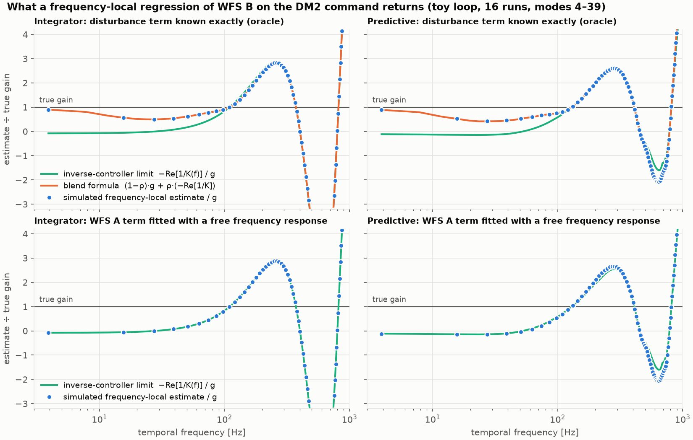
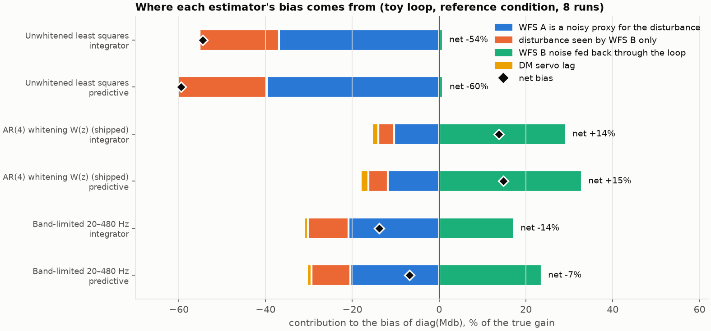
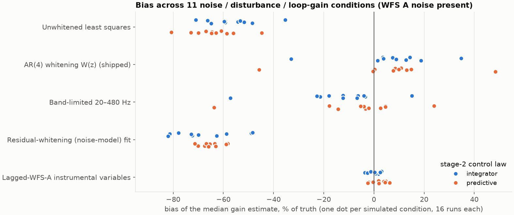
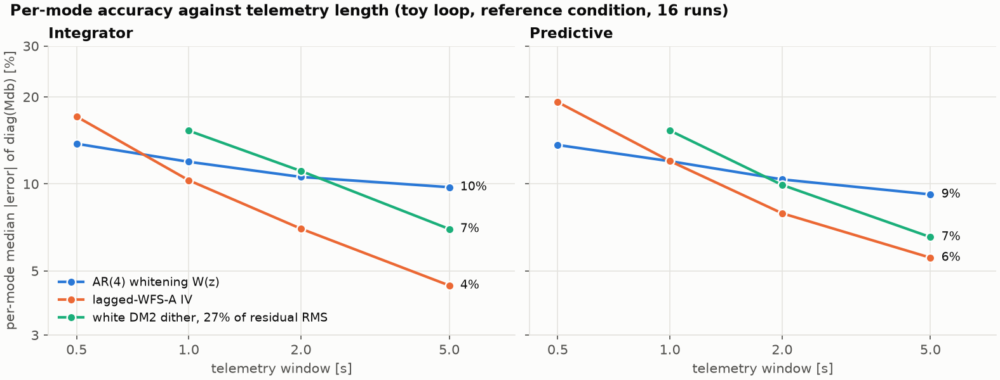

# 2-WFS + 1-DM closed-loop calibration: algorithm analysis, options and opportunities

- **Subject**: the estimator behind `mlt.calib2wfs1dm` / `mlt.sysid` (milk-mltools), which fits `B =
  Mab A + Mdb D + b0` and `A = Mba B - Mda_virt D + a0` from closed-loop telemetry of a two-stage AO
  system.
- **Basis**: a line-by-line reading of `sysid_unit.c`, `tlm_sync_unit.c` and the `mlt.calib2wfs1dm`
  orchestration in `commands.d/mltools.bash`; a closed-form analysis; and a Monte-Carlo study on a
  known-truth two-stage loop model (more than 700 simulated runs).
- **Not used**: the real simulation telemetry. The three run directories behind the published report
  are not on this machine, and the `milk-mlt-calib2wfs1dm` binary is not installed here, so the
  shipped algorithm is represented by a numpy port written from the C source.

> **Status of the evidence.** Statements about what the code does are read from the source.
> Statements about bias are proved for the linear model in Section 3 and confirmed numerically on a
> toy loop. Statements about the real AO3k + SCExAO simulation are predictions, listed with the
> tests that would check them in Section 7.

> **Later results.** This report is the toy-model study as written on 2026-11-19 and is kept as it
> was. Test 3 of Section 7 has since been run on real simulator telemetry: with both loops closed,
> the differenced lagged-A estimator of Section 5.4 reads +2.7% against a probed reference and the
> shipped `W(z)` reads -22% (`../realsim/README.md`). Three later toy analyses (why first
> differences, two-step calibration, other loop frequencies) are in `notes/`. Start from
> `../README.md`.

## Summary

1. **Every regression of `B` on `(A, D)` returns a blend, not the gain.** With any frequency
   weighting `w(f)`, the estimate of an optical gain `g` is a weighted average of `g` (carried by
   DM2 motion that is exogenous to the WFS B residual), of the *inverse controller* `-Re[1/K(f)]`
   (carried by DM2 motion that the loop itself generated from that residual), scaled down by the
   noise in WFS A. The formula reproduces the simulated estimate to two decimals at every frequency
   (Figure 1).
2. **The shipped `AR(4)` whitening is one such blend.** On the toy loop its bias ranges from -46% to
   +48% across 11 conditions and two control laws. It is near zero only where a positive term (WFS B
   noise fed back through the loop) cancels negative ones (WFS A noise, disturbance seen by WFS B
   only). The agreement with `selfRM` in the one real run is therefore compatible with a
   cancellation and does not by itself show that the estimator is accurate.
3. **Held-out `R²` cannot detect this.** It is the criterion used for the ridge, for the lag scan
   and as validation, but in the toy the true matrices predict held-out unwhitened data far worse
   (`R² = -2.40`) than the -58%-biased least-squares solution (`R² = -0.40`).
4. **The robust passive information is DM2 motion driven by what WFS A measures.** An
   instrumental-variable estimator that uses *past* WFS A frames as instruments, and does not let
   the current frame instrument itself, stays within -4% to +6% over the same conditions, with a
   per-mode median error of 3–8% from 5 s of telemetry. It needs WFS A noise or other broadband
   stage-1 content to work, and fails without it. First-differencing the data before the fit
   (Section 5.4) keeps the bias within -2% to +2% even with four times less noise, and is the
   recommended passive form.
5. **Noise-model estimators are not a fix.** Residual-whitening (prediction-error) fitting recovers
   the gain in an idealised setting (1.000 of truth) but gives -82% to -48% in the practical one.
   The same caution applies to the proposed Kalman-EM route.
6. **A small known dither is the reliable active option.** In the toy a white DM2 dither at 27% of
   the residual RMS gives a per-mode error of 7% in 5 s, with a -2% offset that is the DM servo lag
   at the dither's frequencies.
7. **Stage-3 commands are a free probe.** Regressing `B` on the stage-3 command applied to DM2
   returns `g - g_zpo`, the optical gain minus the gain assumed by the zero-point offset: -0.29
   recovered against -0.33 expected.
8. **`Mda_virt` has the right direction but a low amplitude**: 0.73–0.96 of the WFS A optical gain
   in the toy, because the virtual-upstream fit is an unwhitened regression on a noisy `B`.

---

## 1. What was analysed, and how

The toy model is a modal, linear, two-rate closed loop built on the bench's timing: a 1 kHz stage 1
(100 modes, integrator, 1 ms WFS exposure, DM delay plus first-order servo), a 2 kHz stage 2 (40
modes, integrator or pseudo-open-loop AR(8) predictor), an 8 kHz simulation grid, a three-frame
total loop delay in each stage, von Kármán-like modal turbulence, white WFS noise, and optical gains
of 0.93 (WFS A) and 0.67–0.73 (WFS B). WFS B additionally sees a disturbance that the 60 retained
WFS A modes do not contain (stage-1 residual of higher modes, plus a small open-loop term). The true
matrices are known exactly: `Mdb = diag(g)`.

Its job is to expose mechanisms and to rank estimators on equal terms. It is not a substitute for
the full simulator: there is no pyramid non-linearity, no spatial cross-talk, and the predictive
controller is a generic one, not cacao's. Magnitudes should not be carried over to the real system;
signs, scalings and failure modes are what transfer.

| Diagnostic | Real run (published page) | Toy, reference | Toy, noises ÷2 |
| :--- | :---: | :---: | :---: |
| Unwhitened least squares, integrator / predictive | -66% / -50% | -59% / -65% | -71% / -70% |
| Conditional DM excitation `eta_D` (unwhitened) | 0.06 / 0.21 | 0.14 / 0.13 | 0.06 / 0.06 |
| Same, after whitening | 0.91 | 0.96 | 0.97 |
| Residual lag-1 autocorrelation | +0.51 / +0.25 | +0.33 | +0.44 |
| `corr(e_col, D)` | -0.19 / -0.20 | -0.21 | -0.16 |
| `W(z)` gain at DC | -18 dB | -22 dB | -31 dB |
| `AR(4)` `W(z)` error, integrator / predictive | -20% / -0.4% to +2.8% | +9% / +8% | +4% / 0% |

The toy brackets most of the published diagnostics but does not reproduce the real run's strong
difference between control laws under `W(z)`. That difference is itself consistent with the analysis
below (the blend depends on the controller), but it means the toy is a mechanism model, not a fit.

---

## 2. The shipped algorithm, as coded

1. **Alignment** (`commands.d/mltools.bash`, `tlm_sync_unit.c`). The slower stream (A, 1 kHz) is the
   timeline. `B` is resampled with `.mode=window`: each B sample is treated as a cell centred on its
   timestamp and averaged over one A period centred on `t_A + lag_ab`. With B on a half-period grid
   this is the kernel `[1/4, 1/2, 1/4]` at `lag_ab = 0` and `[1/2, 1/2]` at `lag_ab = -0.5` frame.
   `D` is resampled with `.mode=expint`: the held commands are integrated over one A period centred
   on `t_A + (lag_ab - lag_db)`.
2. **Lag scan.** `lag_db ∈ {1.0 … 3.5}` and `lag_ab ∈ {-0.5, 0, 0.5}` B-frames are tried on reduced
   dimensions (32/24/24) with fixed ridges, and the pair with the highest held-out whitened median
   `R²` of `B` is kept.
3. **Whitening** (`sysid_unit.c`, `fit_pooled_ar_taps`). A single `AR(p)` filter is fitted to stream
   **A** (training part, channels pooled at unit variance, 2% ridge on the zero-lag autocorrelation)
   and applied causally to `A`, `B` and `D`.
4. **Solve.** Block normal equations with relative diagonal ridges on the A and D blocks (Schur
   complement). The ridge pair is chosen on a 5 × 4 grid by held-out whitened `R²` over one
   contiguous 70/30 split, then the fit is repeated on the full window.
5. **Refinements.** `Mab` is refitted on unwhitened `B - Mdb D`. The virtual upstream relation `A =
   Mba B + Mda D` is solved from **unwhitened** covariances, and `Mda_virt = -Mda`.

Two facts follow directly. First, filtering all three streams with the same filter and then doing
least squares is identical to least squares with the frequency weight `|W(f)|²`; the filter's phase
and causality do not enter. The shipped method, the report's band-limited prototype and plain least
squares are therefore one family that differs only in `w(f)`. Second, nothing in the pipeline treats
`A` as noisy, and nothing uses the fact that the stage-2 controller is known.

---

## 3. What that family estimates in closed loop

Per mode, at the stage-2 frame rate, with total loop delay `d` frames:

```
B[k] = g (phi[k] + u[k] + D[k-d]) + n[k]        WFS B: measured disturbance phi,
                                                 B-only disturbance u, white noise n
A[k] = gA phi[k] + nA[k]                         WFS A: noisy view of phi
D    = -Kc(z) B                                  known stage-2 controller
K(f) = Kc(f) exp(-2 pi i f d)                    controller including the loop delay
```

### 3.1 Unweighted least squares

Because the DM2 state during exposure `k` was computed from frames `k-d` and earlier, it is
independent of the white noise `n[k]`. Unweighted least squares therefore has **no bias from WFS B
noise**: the measured contribution is +0.8% (Figure 2), and with a noise-free `A` and no B-only
disturbance the estimate is within +3% / +3% of truth. Its large negative bias comes from the two
things that *are* correlated with `D`: the B-only disturbance `u`, which the loop tracks, and the
part of `phi` that a noisy `A` fails to explain. At low frequency the DM2 command is a cleaner copy
of `-phi` than `A` is, so least squares shrinks both coefficients together.

### 3.2 Any frequency weighting: the blend formula

Let `rho(f)` be the fraction of DM2 power at frequency `f` that was generated by feedback of the
unexplained part of `B` (the B-only disturbance, WFS B noise, and whatever a noisy `A` leaves
behind). The frequency-local regression coefficient is

```
g_hat(f) = (1 - rho(f)) g  +  rho(f) (-Re[1/K(f)])
```

and a weighted fit returns the `w(f)`-weighted average of this over the DM2 power. The second term
does not contain `g` at all: where DM2 motion is feedback-driven, the regression measures the
controller, which is the classical closed-loop identification result. For an integrator with a
three-frame delay `-Re[1/K]` is near zero at low frequency, crosses `g` around 100 Hz, reaches about
`+2.8 g` near 250 Hz and swings to large negative and positive values towards the Nyquist frequency
(Figure 1).



Top row: with the disturbance term removed exactly, the simulated estimate (dots) follows the blend
formula (orange) at every frequency; it approaches `g` only where `rho` is small. Bottom row: if the
WFS A term is allowed a free frequency response, everything that WFS A can explain is removed from
`D`, `rho` becomes 1, and the fit returns the inverse controller everywhere. Two consequences:

- A low-frequency weight (plain least squares) pulls the estimate towards zero; a high-frequency
  weight (`W(z)`, or a 20–480 Hz band) pulls it towards the 100–500 Hz part of `-Re[1/K]`, which is
  above `g`. Any value in between can be obtained by choosing the weight, including the true one.
- **Lagged copies of `A` must not be added as regressors.** Doing so gives the WFS A term a free
  frequency response and removes the only robust passive information (bottom row). They belong on
  the instrument side (Section 5.1).

### 3.3 The shipped estimator is a cancellation



Each estimator is linear in `B` once its weights are fixed, so its bias splits exactly into one term
per physical component of `B`: WFS A being a noisy proxy for the disturbance, the disturbance seen
by WFS B only, WFS B noise fed back by the loop, and the DM servo lag. Reference condition, percent
of the true gain:

| Estimator, control law | WFS A proxy | B-only disturbance | WFS B noise | DM lag | Net |
| :--- | ---: | ---: | ---: | ---: | ---: |
| Unwhitened least squares, integrator | -37 | -18 | +1 | 0 | **-54** |
| Unwhitened least squares, predictive | -40 | -21 | +1 | 0 | **-60** |
| AR(4) whitening W(z) (shipped), integrator | -10 | -4 | +29 | -1 | **+14** |
| AR(4) whitening W(z) (shipped), predictive | -12 | -4 | +33 | -2 | **+15** |
| Band-limited 20–480 Hz, integrator | -21 | -9 | +17 | -1 | **-14** |
| Band-limited 20–480 Hz, predictive | -20 | -9 | +24 | -1 | **-7** |

(The attribution uses the spectral form of each estimator; its totals differ from the time-domain
implementation by up to about 5 points.) Whitening removes most of the two negative terms and adds a
large positive one. Which side wins depends on the two WFS noise levels, on the size of the B-only
disturbance and on the controller:



Bias of the median gain, percent of truth, integrator / predictive, 16 runs per cell:

| Condition | Least squares | `AR(4)` `W(z)` | Band 20–480 Hz | Noise-model fit | Lagged-A IV |
| :--- | :---: | :---: | :---: | :---: | :---: |
| reference | -59 / -65 | +9 / +8 | -12 / -3 | -72 / -66 | 0 / +2 |
| both WFS noises ÷2 | -71 / -70 | +4 / 0 | -4 / +5 | -81 / -58 | -4 / -2 |
| both WFS noises ×2 | -48 / -61 | +7 / +11 | -21 / -18 | -49 / -63 | +3 / +6 |
| WFS B noise ×2 | -35 / -45 | +35 / +48 | +15 / +24 | -48 / -59 | +2 / +5 |
| WFS A noise ×3 | -59 / -81 | -33 / -46 | -57 / -64 | -63 / -68 | 0 / 0 |
| B-only disturbance ÷2 | -54 / -59 | +13 / +13 | -6 / +3 | -70 / -65 | +2 / +4 |
| B-only disturbance ×1.7 | -66 / -73 | +1 / 0 | -23 / -14 | -78 / -70 | -3 / -2 |
| no B-only disturbance | -52 / -56 | +14 / +15 | -4 / +5 | -70 / -67 | +3 / +4 |
| no WFS A noise | -28 / -27 | +39 / +31 | -172 / -47 | -29 / -21 | -14 / -1 |
| no WFS A noise, no B-only disturbance | +3 / +3 | +40 / +34 | -172 / -48 | -24 / -21 | -13 / +5 |
| coloured error added to WFS A | -60 / -65 | +9 / +8 | -12 / -4 | -73 / -66 | +1 / +2 |
| stage-2 gain 0.25 | -65 / -67 | +19 / +10 | -18 / -5 | -82 / -71 | -1 / +2 |
| stage-2 gain 0.45 | -53 / -63 | +4 / +8 | -7 / -2 | -59 / -63 | 0 / +2 |

Doubling WFS B noise alone moves the `AR(4)` result to +35% / +48%; tripling WFS A noise alone moves
it to -33% / -46%. The result does not converge with whitening order either: for `p = 1, 2, 4, 8` it
is -8 / +17 / +9 / +1% (integrator) and +2 / +17 / +8 / +6% (predictive) at the reference condition.
Matching the exposure windows exactly changes it by only 1–2 points.

### 3.4 Where the information about `g` actually is

Only DM2 motion that is exogenous to the WFS B residual carries `g`. There are three sources, in
decreasing order of robustness:

1. **Deliberate excitation**: a known dither.
2. **Other commands on DM2 that do not derive from WFS B**: stage-3 (LLOWFS) commands, speckle or
   astrometric-grid probes, offset changes.
3. **The stage-2 response to the disturbance that WFS A measures.** It is usable only if the WFS A
   term is static, which is what exact exposure matching provides, and only through instruments,
   because `A` is noisy.

The loop delay plus a noise model is a fourth, formal source: with the correct noise spectrum the
feedback terms cancel over the full band. In the idealised single-regressor setting this works and
converges with model order (1.007, 1.013, 1.000 of truth for AR(4), AR(16), AR(64); run-to-run SD
0.3%). In the practical setting, with `A` as a noisy regressor that is collinear with `D` at low
frequency, the same procedure gives -82% to -48%, as bad as or worse than not whitening at all. The
implementation was checked on open-loop data, where it reduces the error from 0.52 to 0.07, so the
failure is a property of the problem.

---

## 4. Code-level findings

1. **The lag scan compares targets with different smoothing.** `lag_ab = 0` averages three B frames
   with weights `[1/4, 1/2, 1/4]`; `lag_ab = -0.5` averages the two frames that actually fall inside
   the A exposure. The first has 25% less noise variance in the regressand, so its `R²` is higher
   for a reason unrelated to alignment. In the toy, where the exposure-matched choice is `-0.5` by
   construction, the scan prefers `0` (`R²_w` 0.343 against 0.290), as it did on the real run.
2. **The estimate is sensitive to `lag_db`.** Half a frame either side of the selected value changes
   the `W(z)` result from +10% to +4% / +3% (integrator) and from +10% to -5% / -4% (predictive).
3. **Predictive `R²` is the wrong yardstick.** Unwhitened, the least-squares solution scores -0.40
   on held-out data and the true matrices -2.40. Whitened, the +10%-biased solution scores 0.346 and
   the truth 0.363: a difference of 0.017 separates them.
4. **The whitening filter is fitted to `A`, not to the equation residual**, so it is not a noise
   model in the prediction-error sense. Section 3.4 shows that fitting it to the residual would not
   help.
5. **Noise in `A` is ignored.** In the toy this is the largest negative term for every regression
   estimator (Figure 2).
6. **`Mda_virt` comes from an unwhitened regression on a noisy `B`.** Its amplitude is 0.73–0.96 of
   the WFS A optical gain in the toy. The direction is what an offload needs; the amplitude should
   not be read as an optical gain, and a leaky integrating offload is insensitive to it. The
   `‖Mab·Mda_virt − Mdb‖` cross-check sums estimation noise over 1,600 entries and is not a
   sensitive consistency test.
7. **One contiguous split, no uncertainties.** A block bootstrap over time would give per-mode error
   bars at negligible cost.
8. **`D` omits other DM2 channels.** See Sections 5.3 and 6.
9. **Minor.** The D-block ridge (up to 1%) shrinks `diag(Mdb)` by about that amount; the reported
   `eta_D` includes the ridge; the `selfRM` reference is acquired after the run and with predictive
   filtering off.

---

## 5. Options evaluated

| Option | Toy result (bias of median) | Verdict |
| :--- | :--- | :--- |
| `AR(p)` whitening `W(z)` (shipped) | -46% to +48% | blend |
| Same, exact exposure matching | -43% to +43% | no material change |
| Band-limited 20–480 Hz | -64% to +24% | same family |
| Residual-whitening / noise-model fit | -82% to -48% | fails in practice |
| Lagged-A instrumental variables | -4% to +6% | best passive option |
| Same, on first-differenced data | -2% to +2% | **recommended passive estimator** |
| Known white DM2 dither | -2% to -3% | reliable |
| Stage-3 command as regressor | within 0.01–0.04 of expected | free for low orders |
| Lagged `A` as regressors (dynamic `Mab`) | returns the inverse controller | counter-productive |
| Controller or gain switching | not simulated | adds no exogenous motion |
| Multi-rate Kalman-EM | not simulated | validate against IV first |
| Correlation-locking gain servo | not simulated (literature) | no absolute gain |
| Model-based gain | not simulated (literature) | independent cross-check |

Principle of each option, and remarks:

- **`AR(p)` whitening `W(z)` (shipped)**: weight `abs(W)^2` from the WFS A spectrum. A blend; its
  accuracy depends on the conditions.
- **Same, exact exposure matching**: identical kernels for B and D.
- **Band-limited 20–480 Hz**: weight `1/tr(S_AA)` on a band. Unbounded without a WFS A noise floor.
- **Residual-whitening / noise-model fit**: inverse residual spectrum per output.
- **Lagged-A instrumental variables**: past WFS A frames as instruments. Needs stage-1 broadband
  content.
- **Same, on first-differenced data**: instruments lagged by 2–9 frames.
- **Known white DM2 dither**: the dither is the instrument. The offset is DM dynamics, not estimator
  bias.
- **Stage-3 command as regressor**: its coefficient is `g − g_zpo`.
- **Lagged `A` as regressors (dynamic `Mab`)**: see Section 3.2.
- **Controller or gain switching**: changes `K` between segments; still needs `1 − rho > 0`.
- **Multi-rate Kalman-EM**: full state-space likelihood. Shares the noise-model route's fragility.
- **Correlation-locking gain servo**: Deo et al. 2021: drives modal gains from the residual
  autocorrelation. Keeps the loop tuned without a gain estimate.
- **Model-based gain**: Chambouleyron et al. 2020: predicts the gain from residual statistics, with
  no loop regression.

### 5.1 Lagged-A instrumental variables

Model per mode: `B_i = c_i psi_i + g_i D_i + v_i`, where `psi_i = (Mab A)_i` is the disturbance
predicted from WFS A. Both regressors are treated as endogenous, and the instruments are `psi_i` at
earlier frames. This uses exactly the third information source of Section 3.4 and nothing else, so
it is insensitive to the spectrum of `v` and to white noise in `A`.

| Variant (reference condition) | Bias, int / pred | Per-mode median error, int / pred |
| :--- | :---: | :---: |
| 2 past frames | +3% / +6% | 14% / 17% |
| 4 past frames | +2% / +7% | 11% / 12% |
| 8 past frames | 0% / +2% | 4% / 6% |
| 16 past frames | -1% / 0% | 5% / 6% |
| 32 past frames | -3% / -1% | 6% / 6% |
| 8 past + 2 future frames | +1% / +3% | 5% / 6% |
| 8 past + 8 future frames | -16% / -22% | 16% / 22% |
| 8 past, current frame instruments itself | -64% / -74% | 64% / 74% |
| 8 past, tool alignment (triangle kernel) | +6% / +9% | 8% / 10% |

- **Future frames are invalid instruments** beyond the stage-1 loop delay: stage 1 turns the noise
  of the current WFS A frame into real wavefront a few frames later, so later frames are correlated
  with the current frame's measurement error.
- **The current frame must not instrument itself.** Treating `A` as noise-free costs -64%.
- **Exact exposure matching matters here** (unlike for `W(z)`), because the method relies on the WFS
  A term being static.
- **Strength.** The usable part of the instruments' prediction of the DM2 command is 2.5% of its
  variance at the reference condition, and almost nothing when WFS A is noise-free (0.12%), where
  the estimate degrades to -14% with a per-mode error of 27%. The excitation it relies on is stage-1
  noise propagated through DM1: a brighter star weakens it.



| Window | `AR(4)` `W(z)` | Lagged-A IV | White dither (27% RMS) |
| :--- | :---: | :---: | :---: |
| 0.5 s | +14% / 14% | -9% / 17% | — |
| 1.0 s | +12% / 12% | -2% / 10% | -3% / 15% |
| 2.0 s | +10% / 11% | +1% / 7% | -2% / 11% |
| 5.0 s | +9% / 10% | 0% / 4% | -2% / 7% |

Entries are bias of the median / per-mode median error, integrator. The IV estimate needs about 2 s
before its weak-instrument bias disappears; `W(z)` is bias-limited at every length. The run-to-run
SD of the IV median at 5 s is 1.1% (integrator) and 1.5% (predictive), so a smooth model of gain
against mode index would track the gain curve at the 1–2% level.

### 5.2 Dither

| Dither variance ÷ residual variance | Bias, int / pred | Per-mode error, int / pred |
| :--- | :---: | :---: |
| 0.02 | -2% / -3% | 13% / 13% |
| 0.07 | -2% / -3% | 7% / 7% |
| 0.23 | -2% / -2% | 4% / 4% |

White dither, 5 s, whitened instrumental-variable estimate. The 2–3% offset is not an estimator
bias: a frame-to-frame random command is attenuated by the DM2 servo lag averaged over the WFS
exposure (3.6% in the toy). Because the dither is exogenous, any frequency weighting is allowed
without penalty, and a narrow-band probe placed where the residual spectrum is low would be more
efficient than the white one tested here.

### 5.3 Stage-3 commands

| Case | Coefficient of B on the stage-3 command | Expected `g − g_zpo` |
| :--- | :---: | :---: |
| ZPO at calibration gain 1.0 (mismatch) | -0.29 | -0.33 |
| ZPO scaled by true gain 0.70 (matched) | -0.02 | -0.03 |
| mismatch, stage-3 gain x2 | -0.30 | -0.33 |
| mismatch, stage-3 gain x4 | -0.32 | -0.33 |

Telemetry `B` is taken after the zero-point-offset subtraction, so the stage-3 command appears in it
with coefficient `g − g_zpo`. That is a direct, probe-free reading of the low-order optical gain,
and driving it to zero by adjusting `g_zpo` is a self-calibrating servo. Adding the stage-3 command
as a regressor also improves the low-order `Mdb` estimates (from 0.66 to 0.90 of truth at the
highest stage-3 gain tested), though they stay poor for the reasons in Section 3. In the toy a gain
mismatch multiplies the stage-3 command by `1/g` as seen by its own sensor, which raises its
effective loop gain; the toy stayed stable at the gains tried.

### 5.4 Purely passive use: no dither, no stage-3 probe

If nothing may be injected, the lagged-A method is the one to use, in a first-differenced form:
difference `B`, `psi` and `D` in time, then fit each mode by two-stage least squares with the
differenced `psi` at lags 2 to 9 as instruments. The lag starts at 2 because differencing puts the
previous frame's WFS A noise into the error. Differencing removes the slow directions in which `psi`
and `D` are collinear and every chance correlation is amplified, and it keeps the high-frequency
variation that stage-1 noise creates through DM1.

Bias of the median / per-mode median error, percent, 12 runs per row. Columns: the shipped `W(z)`;
lagged-A by two-stage least squares (2SLS); lagged-A by LIML; the differenced lagged-A form; and
lagged-A with the DM1 command level added to the instruments.

| Condition, window, control | `W(z)` | 2SLS | LIML | **Differenced** | + DM1 level |
| :--- | :---: | :---: | :---: | :---: | :---: |
| reference, 5 s, integrator | +8 | +1 / 5 | +2 / 5 | **+2 / 4** | -71 / 71 |
| reference, 5 s, predictive | +7 | +1 / 5 | +3 / 5 | **0 / 6** | -58 / 58 |
| noises /2, 5 s, integrator | +3 | -3 / 6 | -2 / 5 | **+2 / 5** | -93 / 93 |
| noises /2, 5 s, predictive | 0 | -4 / 6 | -1 / 5 | **-1 / 5** | -78 / 78 |
| noises /2, 10 s, integrator | +3 | -3 / 4 | -2 / 3 | **0 / 3** | -78 / 78 |
| noises /2, 10 s, predictive | 0 | -1 / 4 | 0 / 3 | **0 / 4** | -55 / 55 |
| noises /2, 20 s, integrator | +3 | -1 / 2 | -1 / 2 | **0 / 2** | -63 / 63 |
| noises /2, 20 s, predictive | 0 | -1 / 2 | 0 / 2 | **0 / 3** | -36 / 36 |
| noises /4, 5 s, integrator | -14 | -9 / 9 | -3 / 7 | **0 / 5** | -103 / 103 |
| noises /4, 5 s, predictive | -11 | -10 / 11 | -5 / 10 | **-2 / 5** | -95 / 95 |
| noises /4, 20 s, integrator | -14 | -2 / 3 | -1 / 3 | **0 / 2** | -91 / 91 |
| noises /4, 20 s, predictive | -11 | -1 / 4 | 0 / 4 | **0 / 3** | -62 / 62 |
| noises /4, 40 s, integrator | -14 | -1 / 2 | 0 / 2 | **0 / 1** | -78 / 78 |
| noises /4, 40 s, predictive | -11 | -1 / 3 | 0 / 3 | **0 / 1** | -46 / 46 |
| WFS A noise x3, 5 s, integrator | -32 | +1 / 4 | +2 / 5 | **-1 / 3** | -22 / 22 |
| WFS A noise x3, 5 s, predictive | -43 | -1 / 4 | +2 / 5 | **-2 / 4** | -29 / 29 |

- **Bright stars.** With four times less WFS noise the plain form is biased by -10% to -9% at 5 s
  (weak instruments, pulled towards least squares); the differenced form gives -2% to 0%. LIML
  halves the weak-instrument bias of the plain form but adds 1–2% when the instruments are strong,
  and brings nothing to the differenced form.
- **Window.** About 3–6% per mode from 5 s, 2–3% from 20 s, and 1–2% from 40 s.
- **Do not use the logged DM1 command level as an instrument.** It is a very strong predictor of the
  slow, collinear part of both regressors and gave -103% to -22%. DM1 command increments are
  harmless but add nothing to past WFS A frames.

With the stage-3 loop closed (nothing injected, zero-point offset at the calibration gain), the
low-order modes need its logged command as one more regressor. Estimates on modes 0–3, as a fraction
of the true gain, for the shipped `W(z)`, the differenced lagged-A estimator, and the same with the
logged stage-3 command added:

| Case | `W(z)` | Differenced | + stage-3 command | Stage-3 coefficient (expected) |
| :--- | :---: | :---: | :---: | :---: |
| ZPO at calibration gain 1.0 (mismatch) | 0.54 | 0.91 | **1.00 ± 0.06** | -0.33 (-0.33) |
| ZPO matched to the true gain 0.70 | 0.56 | 0.99 | **1.00 ± 0.05** | -0.03 (-0.03) |
| mismatch, stage-3 gain x4 | 0.66 | 0.60 | **1.02 ± 0.05** | -0.33 (-0.33) |
| mismatch, 20 s window | 0.51 | 0.89 | **0.99 ± 0.03** | -0.33 (-0.33) |

Reading the stage-3 command from telemetry is not an injection: the loop is running anyway. Its
coefficient is the zero-point-offset gain error.

---

## 6. Opportunities

1. **An honest passive gain estimate.** Lagged-A instrumental variables on exposure-matched data,
   per mode, reported with the first-stage strength and a block-bootstrap error bar, and withheld
   when the instruments are weak. Cost is negligible: two unknowns and eight instruments per mode.
2. **A diagnostic that needs no reference.** Plot the frequency-local estimate against `-Re[1/K(f)]`
   computed from the known stage-2 controller. Where the two coincide, DM2 motion is feedback-driven
   and carries no gain information.
3. **Free excitation already on DM2.** Any DM2 command that does not derive from WFS B is a valid
   instrument: LLOWFS, speckle probes, astrometric grids. Logging those channels and projecting them
   on the modal basis costs nothing in wavefront error.
4. **Zero-point-offset self-calibration** from the stage-3 coefficient (Section 5.3).
5. **A verification dither.** A few seconds of small dither gives a reference that does not
   interrupt the loop and is measured in the same loop state as the telemetry, which `selfRM` after
   the run is not.
6. **Gain-curve tracking.** Pooling modes through a smooth gain-versus-mode model turns 5% per-mode
   scatter into a 1–2% curve, enough to rescale modal gains, the predictive filter's `WFSfact` and
   the zero-point offsets.
7. **Offload.** `Mda_virt`'s direction is usable now in a leaky integrating offload. Its amplitude
   should be checked against the stage-1 `selfRM` before it is quoted.

### Suggested order of work

1. Run the tests of Section 7; all but the first use the existing telemetry.
2. Add the lagged-A IV estimate and the inverse-controller diagnostic to the report generator as a
   Python prototype, alongside `W(z)`.
3. If it holds on the real simulator, port it to `mlt.sysid` and make the lag scan compare like with
   like.
4. Add the stage-3 command (and any other DM2 channel) to the regression.
5. Add an optional dither mode for bright stars and for verification.

---

## 7. Tests that would confirm or refute this on the real simulator

1. **Change the noise of one WFS only** (the `ron_e` or `qe` of one pyramid sensor in
   `ao3k_scexao.bench`) and rerun. If the `W(z)` result is a cancellation it should rise with WFS B
   noise and fall with WFS A noise, by several percent or more. A guide-star magnitude change is a
   weaker test because it moves both noises and the two effects oppose. An unbiased estimator would
   not move in either case.
2. **Overlay the frequency-local estimate on `-Re[1/K(f)]`** for the integrator runs, where `K` is
   known exactly.
3. **Compute the lagged-A IV estimate on the same telemetry** and compare it, per mode, with `W(z)`
   and with both `selfRM` definitions.
4. **Repeat the `AR(p)` sweep on an integrator run.** The published sweep is for the predictive run
   only.

---

## 8. Limitations

- The toy is modal, diagonal, linear and stationary. A pyramid's optical gain fluctuates with the
  residual, which adds a multiplicative term that no estimator here models.
- The `W(z)` and band-limited results come from a numpy port of the C code, not from the binary.
- The IV estimator benefits from the toy's diagonal structure. With real, non-diagonal `Mab` it
  depends on a preliminary estimate of the WFS A direction for each B mode.
- A coloured measurement error in WFS A (aliasing) was tested at one level only, where it had no
  visible effect.
- Timestamp conventions of the real telemetry were not available; the alignment findings are stated
  for B frames on a half-period grid of the A frames.
- Controller switching and Kalman-EM were analysed, not simulated.

---

## 9. Reproduction

```bash
cd algo/calib2wfs1dm/toy/code
export OMP_NUM_THREADS=1 OPENBLAS_NUM_THREADS=1 MKL_NUM_THREADS=1
python3 bench.py 16      # 704 runs, about 5 min on 22 cores -> bench.json
python3 theory1.py sig_nA=0.002 sig_nB=0.002 c_hi=0.6   # blend check -> theory_*.npz
python3 extra.py         # dither, held-out R2, lag scan, conditional estimate
python3 stage3.py        # stage-3 channel and zero-point-offset mismatch
python3 iv_variants.py   # passive variants: instruments, LIML, differencing
python3 iv_lowfs.py      # low-order modes with the stage-3 loop closed
python3 figs.py .. --all # figures (needs matplotlib)
python3 build_report.py ..
```

The `.npz` files written by `theory1.py` and `extra.py` are not kept in git; run those two scripts
before `figs.py` or `build_report.py`. See `../README.md` for the interpreter to use.

`sim.py` is the loop model, `estimators.py` the alignment kernels and estimators (including the port
of `mlt.tlmsync` and `mlt.sysid`), `decomp.py` the bias attribution.

## References

Titles and venues were checked by web search; the full texts were not re-read for this study.

- U. Forssell, L. Ljung, *Closed-loop identification revisited*, Automatica 35, 1215–1241 (1999).
  Direct, indirect and joint input-output methods; the direct method needs a correct noise model.
- M. Gilson, P. Van den Hof, *Instrumental variable methods for closed-loop system identification*,
  Automatica 41, 241–249 (2005). The family the lagged-A estimator belongs to, with WFS A as the
  external signal.
- V. Deo et al., *A correlation-locking adaptive filtering technique for minimum variance integral
  control in adaptive optics*, A&A 650, A41 (2021). Tracks the loop-gain × optical-gain product from
  residual autocorrelation, without probes.
- V. Deo et al., *A telescope-ready approach for modal compensation of pyramid wavefront sensor
  optical gain*, A&A 629 (2019).
- S. Esposito et al., *On-sky correction of non-common path aberration with the pyramid wavefront
  sensor*, A&A 636, A88 (2020).
- V. Chambouleyron et al., *Pyramid wavefront sensor optical gains compensation using a
  convolutional model*, A&A 644, A6 (2020). A model-based gain estimate that is independent of loop
  telemetry.
- N. Cerpa-Urra et al., *Cascade adaptive optics: contrast performance analysis of a two-stage
  controller by numerical simulations*, JATIS 8, 019001 (2022).

