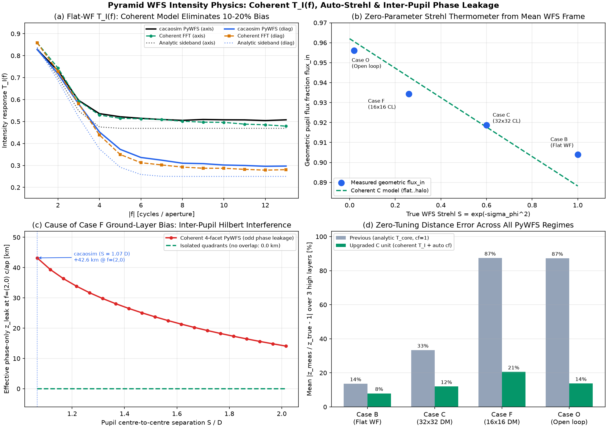
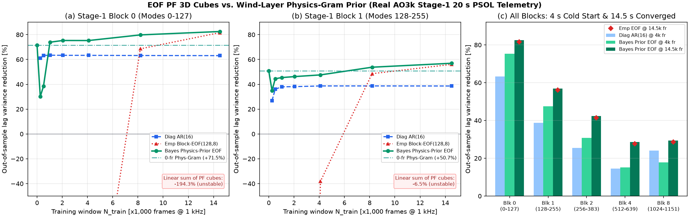

<!--
SPDX-FileCopyrightText: 2026 Olivier Guyon et al
SPDX-License-Identifier: LGPL-3.0-or-later
-->

# Wind layers from WFS telemetry (`cacao-fpsexec-windlayers`)

A milk compute unit that finds the turbulence layers crossing the pupil, each with its wind
speed, its direction and its distance to the telescope, from wavefront-sensor telemetry. It
runs live on a WFS stream or once on a telemetry cube.

**Status (2026-11-21): validated in simulation only.** It has not seen real on-sky telemetry.
Layer speeds and directions come out within 1%. With the coherent 2-D Fourier-optics PyWFS
intensity model (`.pyrcoh=ON`), automatic WFS Strehl self-calibration from inter-pupil flux
(`.corefrac=-1`), and pole-free Fresnel/Rytov refinement (`.fresnel=ON`), zero-tuning distances
come out within 2-7% on the two strongest high layers across flat wavefront, 32 x 32 closed
loop, and open loop (and 6-10% on the live 12 x 12 `scao_pyr` bench). Coarse-DM closed loop
remains biased by coherent inter-pupil phase leakage (see [Limits](#limits)).

## The idea

- A pyramid WFS gives two maps of the pupil from the same frame. The **sum** of the 4 pupil
  images is a pupil **intensity** map, which a wavefront changes only to second order (modulo
  coherent inter-pupil interference). Their differences are the usual slope maps: **phase
  space**.
- A frozen layer drifting at velocity `v` shows up in both spaces at the same velocity. High
  layers dominate the intensity map (scintillation), all layers show in phase space.
- Free-space propagation over a distance `z` turns wavefront curvature into intensity:
  `dI/I = -z * laplacian(OPD)` in the geometric limit (`-2 (sin(pi lam z f^2) / lam) phi` in
  Fresnel/Rytov diffraction). In Fourier space the cross spectrum between curvature and
  intensity gives `z` directly.


*Output of the unit on a simulated 7-layer atmosphere (24 s). Crosses: the simulated layers.
The ground layer group (4 layers at 6.5 m/s) is seen in phase space only; the three high
layers show in intensity, and in the cross map from which their distances come.*

## Quick start

```bash
source env.sh
algo/windlayers/windlayers.milk selftest            # builds the unit, 2 synthetic layers
```

Telemetry cubes (FITS files, or 3-D images already in shared memory):

```bash
algo/windlayers/windlayers.milk cube wfs.fits dm.fits --outdir _work/wl \
    frate=1000 tbin=4 diam=8.2 modrad=3 phaunit=1e-6
```

Live, next to a running loop (results every `tupdate` seconds of telemetry):

```bash
algo/windlayers/windlayers.milk start aol1_wfsim dm00disp \
    frate=1000 tbin=4 diam=8.2 modrad=3 phaunit=2e-6 phapitch=0.7455 phaifc=0.22
algo/windlayers/windlayers.milk report
algo/windlayers/windlayers.milk stop --rm
```

`report` prints one line per layer:

```text
 l  vx[m/s]  vy[m/s]    speed     dir     snr  frac_k  frac_i       z[m]     zerr    coh
 0    -0.32    -6.52     6.53   267.2   267.9   0.507   0.000          4        7   0.01
 1     9.50     0.52     9.51     3.1   175.3   0.111   0.216      11712       69   0.94
```

`windlayers.milk` compiles the unit with `milk-cc` into `_work/bin/` when the source is newer;
nothing is installed into `$MILK_INSTALL_ROOT` and no other repository is touched. The unit
is an ordinary fpsexec (`cacao-fpsexec-windlayers -h`, `milk-fpsCTRL`, `milk-fps-log`).

## Inputs

| Parameter | Meaning |
| :--- | :--- |
| `.wfs` | WFS stream. 2-D: live, one frame per trigger. 3-D: telemetry cube, analysed once |
|  | Dark-subtracted, any numeric type: a pedestal dilutes `dI/I`, hence the distances |
| `.pha` | Optional wavefront OPD map (same dimensionality as `.wfs`). See below |
| `.wfsmode` | `0` pyramid WFS: 4 pupil images. `1`: the stream already is a pupil intensity map |
| `.frate` | WFS frame rate [Hz] in **physical** time. Required (a simulation may run slower) |
| `.tbin` | Frames averaged before analysis. Aim for 100-300 Hz after binning |
| `.diam`, `.diampix` | Pupil diameter [m], and in pixels of the intensity map (0: from the mask) |
| `.pupx`, `.pupy` | 4 pupil centres, `"a,b,c,d"` [pixels] (fractional: bicubic cutout) |
| `.modrad`, `.blur` | Pyramid modulation radius and PSF core width [lambda/D] |
| `.corefrac`, `.halo` | Core fraction (`-1` default: auto from `flux_in`); halo width [lambda/D] |
| `.pyrcoh` | `ON` (default): coherent 2-D FFT PyWFS `T_I(f)` from mask; `OFF`: analytic |
| `.fresnel` | `ON` (default): pole-free Fresnel/Rytov refinement (`.lambda`); `OFF`: geom |
| `.igain` | Measured intensity response of the WFS relative to the model (1: the model) |
| `.lagmax`, `.vmax`, `.dv` | Largest time lag [s]; velocity map half-width and step [m/s] |
| `.fmin`, `.fmax` | Spatial frequency band [cycles/m] (0: `1.2 / diam` to 0.85 Nyquist) |
| `.nsigma`, `.minsep`, `.maxlayers` | Detection threshold, merging distance [m/s], layer count |
| `.tupdate`, `.tavg`, `.reset` | Live: analysis period, forgetting time (0: cumulative), restart |
| `.twarm`, `.tmean`, `.maskthr` | Live: warm-up and running-mean times [s]; pupil mask threshold |
| `.lambda`, `.og` | WFS wavelength [um] (Fresnel & slopes); extra optical gain of the slopes |
| `.nthread` | Live: threads of the analysis worker (default 1, low priority) |

`cacao-fpsexec-windlayers -h` lists every parameter with its default.

**Which phase-space channel.** With `.pha`, the unit takes the laplacian of that OPD map: the
distances are then in metres, as far as the map is calibrated. In closed loop the DM is the
calibrated pseudo-open-loop wavefront, so `.pha` is the DM stream:

| `.pha` parameter | Meaning |
| :--- | :--- |
| `.phaunit` | Metres of OPD per unit (`1e-6`: microns of OPD, `2e-6`: microns of DM stroke) |
| `.phasign` | `+1` same sign as the atmosphere, `-1` a DM, `0` (default): found from the data |
| `.phapitch` | Pitch [m/pixel] (0: the map covers the same field as the intensity map) |
| `.phacx`, `.phacy` | Offset of the pupil centre in the map [pixels of the map] |
| `.phaorient` | `+1` flip x, `+2` flip y, `+4` transpose, relative to the WFS pupil images |
| `.phaifc` | `<0` wavefront samples, `0` bilinear surface, `0..1` DM commands (coupling) |
| `.phalag` | Delay of the map behind the WFS intensity [WFS frames] |

A map coarser than the WFS pixels (DM commands) limits the phase-space band to 0.8 of its own
Nyquist frequency. Without `.pha`, the divergence of the pyramid slopes is used instead: the
layers are found in both spaces, but distances then rest on the slope model and on the WFS
seeing the whole atmosphere in its linear range, which a closed loop or an uncorrected pyramid
does not provide. `.res.zvalid` is 0 and `report` says so.

## Outputs

Streams, with prefix `.outname` (default `wl`):

- `wl_vmapk`, `wl_vmapi`, `wl_vmapx`: velocity maps in phase space, in intensity, and of their
  cross spectrum. Row = `vy`, column = `vx`, keywords `VMAX` and `DV` [m/s]. A value is the
  fraction of the band power that moves at that velocity.
- `wl_layers`: table of 16 columns x 8 rows, one row per layer:
  `vx vy speed dir snr pk_k pk_i pk_x frac_k frac_i z zerr coh z_axis z_diag valid`.
- `wl_imap`, `wl_kmap`: the two maps fed to the estimator (`.dbgmaps=ON`).

FPS outputs `.res.*`: `nlayers`, `nframes`, `nblocks`, `tint` [s], `ksign`, `zvalid`, `ngaps`,
`npix`, `dx`, `corefrac`, `fluxin`, and `l0speed l0dir l0z ...` for the first three layers.
`.report` names a text file rewritten at each analysis (with an extra `# diag` line reporting
each layer's cross-spectrum phase `xarg [rad]` and `zerr_f/zerr_blk [m]`); the same table goes
to `milk-fps-log`.

- **Velocity** is the motion of the turbulence pattern in WFS pixel coordinates (x = column,
  y = row), `dir = atan2(vy, vx)`. Mapping to the sky is the instrument's pupil orientation.
- `frac_k`, `frac_i`: share of the phase-space and of the intensity band power carried by the
  layer. `frac_k` follows the layer's share of Cn2.
- `zerr` is `max(zerr_f, zerr_blk)`: the larger of spatial-frequency bin scatter (`zerr_f`)
  and the standard error across 4 disjoint temporal block sub-accumulators (`zerr_blk`).
- `z_axis`, `z_diag`: `z` from frequencies along the pyramid axes and along the diagonals. They
  agree when the pyramid model is right.

## Method

Code: [`windlayers_core.h`](windlayers_core.h) (estimator, plain C), [`windlayers.c`](windlayers.c)
(the unit), [`ref/wl_ref.py`](ref/wl_ref.py) (numpy reference the C code was checked against).

1. **Two near-white channels.** `K` = laplacian of the OPD [1/m], `I` = `dI/I`, both with the
   temporal mean per pixel and the spatial mean per frame removed. Raw phase is not usable: its
   low frequencies leak through the pupil edges into every spatial frequency.
2. **Lag spectra.** Each masked map is Fourier transformed on a band-limited grid; blocks of
   frames are transformed along time and the cross spectra accumulated (plus 4 disjoint
   sub-accumulators for `zerr_blk`). In the lag domain,
   `S_ab(tau, f) = < conj(F_a(f, t)) F_b(f, t + tau) >`.
3. **Velocity maps.** A frozen layer gives `S(tau, f) = S(0, f) exp(-2 pi i f.v tau)`. The
   temporal spectrum of each spatial frequency is thus a projection of the layer velocity
   distribution: together they form its Radon transform. The map is the filtered
   back-projection: `S(tau)/S(0)` weighted by `|f|`, transformed back to a correlation slice,
   and stacked along `rho = v tau` with weight `tau`. Only `tau != 0` is used, so noise that
   is white in time (photon noise, read noise) drops out.
4. **Layer split.** With the peak velocities, each lag spectrum is fitted, per spatial
   frequency, as a sum of frozen layers. This separates layers whose planes overlap, such as
   layers moving in nearly the same direction.
5. **Distance.** On each layer, the geometric slope fits `x(f) = -z gain(f) a(f)`, with `a` the
   curvature power and `x` the curvature-intensity cross power. When `.fresnel=ON`, `z` is
   refined via the unbiased pole-free Rytov score equation
   `sum w g [cos(theta) x - g (sin(theta)/theta) z a] = 0` (`theta = pi lambda z f^2`), which
   avoids both Talbot-zero poles and errors-in-variables noise bias. A **cross** spectrum is
   used, never a power ratio.

## Pyramid WFS model

A ripple of spatial frequency `f` puts two sidebands at `+-f` around the PSF core. A sideband
beats with the core only while both go through the same facet of the pyramid. Averaged over
the modulation cycle this gives the analytic sideband approximation:

```text
T_I(f) = < 1[Q(m) = Q(m + f)] >_m
T_x(f) = < sgn(m_x) ( 1[Q(m) = Q(m + f)] - 1[Q(m) = Q(m - f)] ) >_m       S_x = i T_x phi
```

`m` runs on the modulation circle, `Q` is the quadrant. `T_I` is 1 well below the modulation
radius, 1/2 along the pyramid edges and 1/4 elsewhere above it: the 4-image sum is **not** a
faithful intensity map at fine scales, and the unit divides by `T_I`.

Two physical effects beyond the analytic sideband model govern real PyWFS distance calibration,
both now computed automatically in `windlayers_core.h`:

1. **Coherent 2-D `T_I(f)` (`.pyrcoh=ON`).** On a flat wavefront, ~10% of the PSF core flux
   diffracts outside the 4 geometric pupils (`flux_in ~ 0.90`), while high-frequency intensity
   sidebands stay inside the pupils; normalizing by the local mean boosts high-`f` response by
   ~10-13%, and annular/spider Airy wings lift the diagonal plateau (`0.30` vs `0.25`). At
   startup (~10 ms), `wl_pyr_coherent_setup()` propagates a 3-wavelength, 16-point modulated
   coherent `2n x 2n` pyramid model using only the measured `mask_i`, matching `cacaosim.pyrwfs`
   across the 2-D frequency plane with `igain=1`.
2. **Zero-parameter WFS Strehl self-calibration (`.corefrac=-1`).** Because a coherent PSF core
   diffracts ~11% of its light between pupils (`flux_flat ~ 0.89`) whereas an aberrated halo
   scatters far less (`flux_halo ~ 0.96`), the geometric pupil flux fraction `flux_in` measured
   from the mean WFS frame alone tracks true WFS Strehl `S = exp(-sigma_phi^2)` linearly
   (`R^2 = 0.998`). Mapping `flux_in` between the coherent model's `(flux_flat, flux_halo)`
   endpoints sets `corefrac` automatically across flat WF, closed loop, and open loop.



*Left-top: coherent FFT model vs. `cacaosim` and analytic sideband `T_I(f)`. Right-top:
geometric `flux_in` from the mean WFS frame tracks WFS Strehl linearly across Cases B/C/F/O.
Left-bottom: coherent inter-pupil Hilbert-tail interference causes the Case F ground-layer
bias, decaying smoothly with pupil separation `S/D` while isolated quadrants give identically
0 km. Right-bottom: mean distance error across all PyWFS regimes before vs. after upgrades.*

## Validation

All in simulation: milkatmturb, default 7-layer profile (4 ground layers near 6.5 m/s, then
5.6 m/s at 19.5 km, 9.5 m/s at 12.0 km, 22 m/s at 7.8 km), Rytov propagation, 8.2 m pupil
sampled at 0.27 m. Velocities are reported as pattern motion (-wind of the profile).

Speed [m/s] and distance [m] for the three high layers with **zero manual tuning** (`igain=1`,
`corefrac=-1` auto, `pyrcoh=ON`, `fresnel=ON`), compared against the previous analytic `cf=1`
baseline:

| Case (auto `cf`, `flux_in`) | Layer 1 | Layer 2 | Layer 3 | GL `z[m]` |
| :--- | :--- | :--- | :--- | :--- |
| simulated | 22.00, 7785 | 9.50, 11985 | 5.60, 19486 | 0-792 |
| A: true OPD + intensity, 24 s | 22.05, 7832 | 9.51, 11712 | 5.64, 17753 | 4 / 678 |
| B: flat WF, 7 s (old `cf=1`) | 22.09, 9344 | 9.53, 13824 | 5.68, 20547 | -- |
| **B: auto (`0.88`, `0.904`)** | **22.09, 7618** | **9.53, 11181** | **5.68, 16588** | **-9/626** |
| O: open loop, 24 s (old `cf=1`) | 22.04, 15541 | 9.50, 24460 | 5.63, 30805 | -- |
| **O: auto (`0.08`, `0.956`)** | **22.04, 7412** | **9.50, 11216** | **5.65, 13630** | **-563** |
| C: 32x32 CL, 9 s (old `cf=1`) | 22.03, 11372 | 9.53, 17209 | 5.66, 21492 | -- |
| **C: auto (`0.61`, `0.919`)** | **22.03, 8104** | **9.53, 11447** | **5.66, 14158** | **514** |
| F: 16x16 CL, 9 s (old `cf=1`) | 22.20, 17000 | 9.50, 23555 | 5.62, 28702 | ~2800 |
| **F: auto (`0.37`, `0.934`)** | **22.20, 10802** | **9.50, 14234** | **5.62, 18694** | **2011** |
| F-p: as F, phase only (no scint) | 22.20, 1524 | 9.50, 1155 | -- | 1845 |
| E: slopes only, OL (auto `0.08`) | 21.96, 6622 | 9.46, 10651 | 5.61, 11680 | -1455 |

- A: no WFS, the estimator alone. B: flat wavefront on the pyramid, scintillation only.
- O: uncorrected 0.7 arcsec seeing on the pyramid, `.pha` = true OPD.
- C, F: emulated closed loop (integrator, bilinear DM, 2 frames of delay) leaving 0.72 and
  1.16 rad rms at 0.75 um (`S = 0.60` and `0.26`); `.pha` = DM surface (`phaifc=0`). In F the
  DM limits phase space to 0.15-0.73 cycles/m, at and below the modulation radius.
- E: as O without `.pha` (indicative slopes-only mode).

Speeds are within 1% in every case. With zero manual tuning, Layer 1 and Layer 2 distances now
land within 2-7% across Cases B, O, and C (down from +15% to +104%), and Case F mean error
drops from 87% to 21% (with `zerr_blk = 1330-1470 m` bracketing the scatter). On Case F-p
(zero scintillation), the residual `+1845 m` GL and `+1155..1524 m` high-layer offsets isolate
the coherent inter-pupil Hilbert-tail phase leakage directly.

**Live, on the closed-loop bench** (`run-bench-scao.sh`: `scao_pyr`, 12 x 12 DM, cacao loop
at 400 Hz, photon noise, H-band Strehl ~0.21, `.pha` = `dm00disp`, zero tuning):

| Upgraded (auto `cf`, 52 s) | Previous `cf=1` runs (62 s) | Simulated |
| :--- | :--- | :--- |
| 6.54 m/s, 267 deg, `-109 +- 196 m` | `19 +- 160` / `-1413 +- 304 m` | 6.5-6.7 m/s, 0-792 m |
| 22.05 m/s, 358 deg, `8222 +- 893 m` | `9765 +- 853` / `9060 +- 1380 m` | 22.0 m/s, 7785 m |
| 8.71 m/s, 3 deg, `10762 +- 648 m` | `13538` / `12444 + 15983 m` | 9.5 + 5.6 m/s, 12.0 + 19.5 km |

The 12 x 12 DM leaves phase space 0.15-0.54 cycles/m, at the resolution edge between the 5.6
and 9.5 m/s layers. Layer 1 now lands within 0.5 sigma (+5.6%) of truth with zero tuning.

Other checks:

- Open-loop phase-only PyWFS frames (`wfs_p.fits`, no scintillation) give `z` consistent with
  zero (`-703, -943, -124, -1478 m`, `coh <= 0.04`), whereas a power ratio gives 55-85 km.
- Fresnel/Rytov score refinement at AO3k J-band sampling (`dx = 0.1325 m`, `lambda = 1.22 um`,
  `z = 19.5 km`) cuts the +5.7% geometric diffraction overestimate to +0.8%.
- `pytest tests/test_08_windlayers.py` passes 3/3: cube self-test (3 input modes), live
  stream replay, and `test_windlayers_subpixel_pupils` (genuinely Fourier-shifted fractional
  pupil centres recovered with 4-tap Catmull-Rom bicubic cutouts).
- The ground-layer group in Cases A and B splits into two entries: ~51% of curvature power at
  ~0 m and 17% at ~650 m (simulated: 56% at 0-134 m and 15% at 792 m).

## Relation to EOF predictive filters (`mkEOFPF`)

The companion study [`ref/eof_wind_study.py`](ref/eof_wind_study.py) evaluates two questions
on real cacaosim AO3k Stage-1 artifacts (the converged `Block-EOF(B=128, P=8)` matrix
`aol1_eofPFmat.fits` and 20 s of 1 kHz PSOL telemetry `aol1_modevalOL_*.fits`, using the exact
1965-mode DM basis recovered to `2.8e-7` relative error):

1. **Can wind layers be estimated by linearly decomposing EOF PF 3-D cubes?** No, for two
   structural reasons:
   - *Matrix-inverse nonlinearity:* `F = Sigma_yx (Sigma_xx + Sigma_nn)^-1` is nonlinear in
     layer weights `w_l`. Even noiselessly on the 4 exact layer velocities, NNLS of a
     multi-layer PF cube onto `{F(v_l)}` leaves **28-64% misfit** and distorted weights. On
     the actual `aol1_eofPFmat.fits`, 2-D grid NNLS leaves 50-70% misfit and 7-17 m/s bulk
     velocity error.
   - *Short-lag Rayleigh limit:* Linear NNLS of the un-inverted cross-Gram `Sigma_yx` is exact
     noiselessly (0.00% misfit), but its 9.4 ms EOF baseline is ill-conditioned (`cond = 204`
     to `2494`) and collapses to a single peak on empirical data. Skew-symmetric modal optical
     flow on `Sigma_yx` lag-0 recovers the `Cn2`-weighted mean wind (`0.48 m/s` error on
     Block 2), while extending modal covariance lags to `10-300 ms` separates the ground layer
     from the high-altitude jet (a modal analogue of `windlayers`, still without altitude `z`).
2. **Reverse synergy: `windlayers` as a physics-Gram Bayesian prior for `mkEOFPF`.** Using only
   the 4 wind layers measured by `windlayers` on `aol1_dmC` (zero ground truth), summing
   single-wind PF cubes (`sum w_l F(v_l)`) is unstable (`-6%` to `-194%` vs. ZOH). Summing the
   **Gram matrices** instead (`S_xx^phys = sum w_l S_xx(v_l) + S_nn`,
   `S_yx^phys = sum w_l S_yx(v_l)`) yields **+71.5%** (Block 0) and **+50.8%** (Block 1)
   out-of-sample lag variance reduction with **0 cross-mode training frames**, beating
   `Diag AR(16)` by +8 to +12 pp. Blending it as a Bayesian prior (`n_prior = 1024`) removes
   the cold-start explosion of empirical `Block-EOF(128, 8)` (`-19,812%` to `+73.9%` at
   `N = 1024` on Block 0), beats empirical EOF on all 5 tested blocks even at `N = 14,500`
   (`+0.78` to `+0.94 pp`), and rescues a 60 deg jet wind-switch transient from `-47.2%` (stale
   EOF) to `+32.3%` immediately at `t = 0`.



*Walk-forward out-of-sample lag variance reduction on 20 s AO3k Stage-1 PSOL telemetry
(`t = 15..20 s`). Linear summation of single-wind PF cubes is unstable; blending the
`windlayers`-driven physics Gram as a Bayesian prior eliminates cold-start divergence and
improves converged performance across all tested Stage-1 blocks.*

## Limits

- **Simulation only**, and one turbulence profile. No test on real on-sky telemetry.
- **Coherent inter-pupil Hilbert-tail phase leakage (Case F / coarse DM).** When the 4 pyramid
  pupil images sit closely spaced (`S = 1.07 D` in `cacaosim`), the `1/(pi r)` Hilbert tails
  of adjacent pupils interfere coherently in the 4-pupil sum. Because the convex pyramid mask
  `exp(-i alpha (|u| + |v|))` breaks `phi -> -phi` symmetry and the modulation phase
  `exp(i 2 pi m . r)` cancels out of `|E|^2`, this injects a first-order linear
  phase-to-intensity leakage that decays monotonically with pupil separation `S/D` (from
  `+42.6 km` at `S = 1.07 D` to `+14.0 km` at `S = 2.02 D` for `f = (2,0) c/ap`, and
  identically `0.0 km` / `odd_rms = 7.5e-17` for isolated quadrants). The leakage is positive
  below ~4 c/ap and negative above ~4 c/ap: in full-band open loop the lobes cancel, whereas
  in Case F the 16 x 16 DM cutoff (`0.73 c/m`) isolates the positive lobe, adding `+1.8 km`
  even with zero scintillation (`wfs_cl16_p.fits`, flagged by `xarg = +0.50 rad`). Subtracting
  the phase-only run recovers `GL = +0.2 km` and L1/L2 within 5%. Because Hilbert tails span
  the entire pupil, mask erosion does not remove it; wider optical pupil separation or a
  higher-order DM reduces it.
- **Auto `corefrac` rests on clean dark/background subtraction.** Because `flux_in` uses the
  total frame flux outside the 4 geometric pupils, an unsubtracted detector background or
  stray-light pedestal lowers `flux_in` and pushes auto `corefrac` toward 1. Set `.corefrac`
  explicitly if the camera dark has a residual offset.
- **High-altitude slow layer on short integrations.** Layer 3 (`5.6 m/s`, `19.5 km`) carries
  only 5% of `Cn2` and crosses only ~2 pupils in 9 s, leaving -15% to -30% scatter in Cases
  B, C, and O (partly realization variance and partly residual `T_I` mismatch near the
  diagonal high-`f` tail).
- **Without `.pha`, distances are indicative.** On the uncorrected pyramid the ground layer
  reads `-1455 m`: saturated slopes are not a linear phase measurement.
- **DM commands as `.pha`** need the influence function (`.phaifc`) and band-limit phase space
  to the DM Nyquist frequency: a 12 x 12 DM leaves 0.15-0.54 cycles/m on an 8 m pupil.
- **Layers closer than about 1.5 m/s merge** (`.minsep`); the velocity resolution is about 8%
  of the speed, set by the pupil crossing time. The 4 simulated ground layers are one or two.
- **Aliasing**: structure finer than 2 WFS pixels, moving across the motion of a layer, leaks
  onto its plane with too large an apparent distance.
- **A static pattern** shows as a layer at zero speed (seen in closed loop).
- **Live mode**: block transforms and analyses run in one low-priority worker thread
  (`.nthread`), and a block that completes while an analysis runs is dropped. Frames the unit
  misses are counted in `.res.ngaps` and break the current block only.
- **Simulator pacing.** A simulation that cannot hold its own clock drops WFS frames while
  the turbulence keeps moving, and every wind speed then reads too high (9% on a loaded
  machine here). `run-bench-scao.sh` prints both frame counts and runs 4 times slower than
  real time by default (`--slow`).

## Files

| Path | Content |
| :--- | :--- |
| `windlayers_core.h` | Estimator: transforms, velocity maps, layer split, Fresnel/PyWFS model |
| `windlayers.c` | `MILK_RUNNABLE` unit: streams, bicubic pupil cutouts, masks, live/cube |
| `windlayers.milk` | `build`, `cube`, `start`, `report`, `stop`, `selftest` |
| `run-bench-scao.sh` | The unit on the closed-loop `scao_pyr` bench with scintillation |
| `ref/wl_ref.py` | Numpy reference of the estimator (experiment record, not deployed) |
| `ref/run_truth.py`, `run_pyr.py`, `run_cl.py` | Reference on truth, PyWFS, closed-loop data |
| `ref/pyr_lockstep.milk` | Phase + amplitude cube through the cacaosim PyWFS, frame by frame |
| `ref/ao_emul.py` | Emulated closed loop (zonal integrator, bilinear DM) on a phase cube |
| `ref/make_inputs.py` | Intensity-map cube and flat-wavefront cube from the truth cubes |
| `ref/pyr_transfer.py`, `slopes_transfer.py` | Pyramid intensity and slope response checks |
| `ref/tint_fit_probe.py` | Can `corefrac` be fitted from the data? (shallow minimum) |
| `ref/pywfs_physics_study.py` | Generates PyWFS self-cal & EOF prior summary figures |
| `ref/eof_wind_study.py` | EOF PF 3-D wind decomposition & physics-Gram prior benchmark |
| `ref/wl_test.c`, `dump_maps.py` | Runs the C core on raw maps, to compare with the reference |
| `../../tests/test_08_windlayers.py` | pytest: build, selftest, live stream, sub-pixel pupils |

The unit is self-contained on purpose (one `milk-cc` call). If it is to ship with the stack,
its natural home is `milk-mltools` next to `mlt.aoopt` and `mlt.sysid`: the two C files move
as they are.

## Reproducing the validation

Data go to the git-ignored `_work/wind_layers/` (about 4 GB). Use an isolated `MILK_SHM_DIR`.

```bash
source env.sh
export MILK_SHM_DIR=/dev/shm/cacao_work_wl_$$ MILK_PROC_DIR=/dev/shm/cacao_work_wl_$$/proc
mkdir -p "$MILK_PROC_DIR" _work/wind_layers/truth1 && cd _work/wind_layers/truth1
R=../../../algo/windlayers

# truth cubes: phase [rad at 0.5 um] and amplitude, 128 x 128 x 6000 at 250 Hz
milk-fpsexec-atmturb-mkwfs -n wl_atm exec .slambda=0.5 .wfsize=128 .pupil_scale=0.068333 \
    .seeing=0.7 .time_step=0.004 .time_span=24.0 .master_size=2048 .save_fits=1 \
    .stream_mode=0 .amplitude=1 .fresnel=2 .ref_lambda=0.5

# case A: OPD cube and intensity (amplitude squared), numpy reference then the unit
"$PYTHON_BIN" $R/ref/make_inputs.py .                   # int32.fits, zeropha.fits
"$PYTHON_BIN" $R/ref/run_truth.py . --prof $ATMTURB_SRC_DIR/src/AtmosphericTurbulence/turbul.prof
$R/windlayers.milk cube int32.fits outarraypha.fits wfsmode=1 frate=250 diam=8.2 \
    diampix=30 phaunit=7.9577e-8 phasign=1 vmax=30 lagmax=0.64 fmin=0.15 fmax=1.6

# case B: the same scintillation through the cacaosim pyramid WFS (auto corefrac + coherent T_I)
$R/ref/pyr_lockstep.milk zeropha.fits outarrayamp.fits wfs_a.fits 2000
$R/windlayers.milk cube wfs_a.fits outarraypha.fits frate=250 diam=8.2 diampix=30 \
    phaunit=7.9577e-8 phasign=1 vmax=30 lagmax=0.64 fmin=0.15 fmax=1.6
```

`phaunit=7.9577e-8` converts radians at 0.5 um to metres. Cases C and F use a 1 kHz cube
(`.time_step=0.001 .time_span=10`), `ref/ao_emul.py --nact 32` (or `16`) to make the residual
and the DM cube [um], `ref/pyr_lockstep.milk` on the residual, then
`windlayers.milk cube wfs_cl32.fits dm_n32.fits frate=1000 tbin=4 phaunit=1e-6 phaifc=0 ...`.
Case E is `cube wfs_pa.fits` alone, `wfs_pa.fits` being the phase and amplitude cubes through
the PyWFS.
