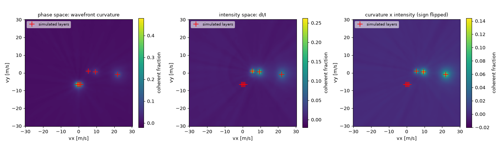
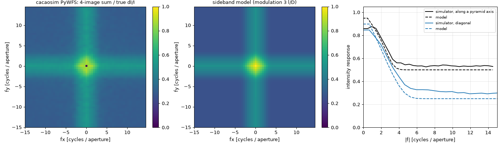

<!--
SPDX-FileCopyrightText: 2026 Olivier Guyon et al
SPDX-License-Identifier: LGPL-3.0-or-later
-->

# Wind layers from WFS telemetry (`cacao-fpsexec-windlayers`)

A milk compute unit that finds the turbulence layers crossing the pupil, each with its wind
speed, its direction and its distance to the telescope, from wavefront-sensor telemetry. It
runs live on a WFS stream or once on a telemetry cube.

**Status (2026-11-20): validated in simulation only.** It has not seen real telemetry. Layer
speeds and directions come out within 1%. Distances are within 9% when the intensity is known
directly, but through a pyramid WFS they rest on an intensity response that the model gives
to 10-20% at best, and they came out up to twice too far in closed loop with a coarse DM (see
[Limits](#limits)).

## The idea

- A pyramid WFS gives two maps of the pupil from the same frame. The **sum** of the 4 pupil
  images is a pupil **intensity** map, which a wavefront changes only to second order. Their
  differences are the usual slope maps: **phase space**.
- A frozen layer drifting at velocity `v` shows up in both spaces at the same velocity. High
  layers dominate the intensity map (scintillation), all layers show in phase space.
- Free-space propagation over a distance `z` turns wavefront curvature into intensity:
  `dI/I = -z * laplacian(OPD)`. In Fourier space the ratio of intensity to OPD grows as
  `4 pi^2 z f^2`, so the relative strength of the two versus spatial frequency gives `z`. At
  WFS sampling (pixels of 10-30 cm) this is purely geometric: no wavelength enters.



*Output of the unit on a simulated 7-layer atmosphere (24 s). Crosses: the simulated layers.
The ground layer group (4 layers at 6.5 m/s) is seen in phase space only; the three high
layers show in intensity, and in the cross map from which their distances come.*

## Quick start

```bash
source env.sh
algo/windlayers/windlayers.milk selftest            # builds the unit, 2 synthetic layers
```

Telemetry cubes (FITS files, or 3-D images already in shared memory):

```bash
algo/windlayers/windlayers.milk cube wfs.fits dm.fits --outdir _work/wl \
    frate=1000 tbin=4 diam=8.2 modrad=3 phaunit=1e-6
```

Live, next to a running loop (results every `tupdate` seconds of telemetry):

```bash
algo/windlayers/windlayers.milk start aol1_wfsim dm00disp \
    frate=1000 tbin=4 diam=8.2 modrad=3 phaunit=2e-6 phapitch=0.7455 phaifc=0.22
algo/windlayers/windlayers.milk report
algo/windlayers/windlayers.milk stop --rm
```

`report` prints one line per layer:

```text
 l  vx[m/s]  vy[m/s]    speed     dir     snr  frac_k  frac_i       z[m]     zerr    coh
 0    -0.32    -6.52     6.53   267.2   267.9   0.507   0.000          4        7   0.01
 1     9.50     0.52     9.51     3.1   175.3   0.111   0.216      11719       72   0.94
```

`windlayers.milk` compiles the unit with `milk-cc` into `_work/bin/` when the source is newer;
nothing is installed into `$MILK_INSTALL_ROOT` and no other repository is touched. The unit
is an ordinary fpsexec (`cacao-fpsexec-windlayers -h`, `milk-fpsCTRL`, `milk-fps-log`).

## Inputs

| Parameter | Meaning |
| :--- | :--- |
| `.wfs` | WFS stream. 2-D: live, one frame per trigger. 3-D: telemetry cube, analysed once |
|  | Dark-subtracted, any numeric type: a pedestal dilutes `dI/I`, hence the distances |
| `.pha` | Optional wavefront OPD map (same dimensionality as `.wfs`). See below |
| `.wfsmode` | `0` pyramid WFS: 4 pupil images. `1`: the stream already is a pupil intensity map |
| `.frate` | WFS frame rate [Hz] in **physical** time. Required (a simulation may run slower) |
| `.tbin` | Frames averaged before analysis. Aim for 100-300 Hz after binning |
| `.diam`, `.diampix` | Pupil diameter [m], and in pixels of the intensity map (0: from the mask) |
| `.pupx`, `.pupy` | Centres of the 4 pupil images, `"a,b,c,d"` [pixels]. Empty: frame quadrants |
| `.modrad`, `.blur` | Pyramid modulation radius and PSF core width [lambda/D] |
| `.corefrac`, `.halo` | Fraction of the light in the PSF core; width of the rest [lambda/D] |
| `.igain` | Measured intensity response of the WFS relative to the model (1: the model) |
| `.lagmax`, `.vmax`, `.dv` | Largest time lag [s]; velocity map half-width and step [m/s] |
| `.fmin`, `.fmax` | Spatial frequency band [cycles/m] (0: `1.2 / diam` to 0.85 Nyquist) |
| `.nsigma`, `.minsep`, `.maxlayers` | Detection threshold, merging distance [m/s], layer count |
| `.tupdate`, `.tavg`, `.reset` | Live: analysis period, forgetting time (0: cumulative), restart |
| `.twarm`, `.tmean`, `.maskthr` | Live: warm-up and running-mean times [s]; pupil mask threshold |
| `.lambda`, `.og` | Without `.pha`: WFS wavelength [um] and extra optical gain of the slopes |
| `.nthread` | Live: threads of the analysis worker (default 1, low priority) |

`cacao-fpsexec-windlayers -h` lists every parameter with its default.

**Which phase-space channel.** With `.pha`, the unit takes the laplacian of that OPD map: the
distances are then in metres, as far as the map is calibrated. In closed loop the DM is the
calibrated pseudo-open-loop wavefront, so `.pha` is the DM stream:

| `.pha` parameter | Meaning |
| :--- | :--- |
| `.phaunit` | Metres of OPD per unit (`1e-6`: microns of OPD, `2e-6`: microns of DM stroke) |
| `.phasign` | `+1` same sign as the atmosphere, `-1` a DM, `0` (default): found from the data |
| `.phapitch` | Pitch [m/pixel] (0: the map covers the same field as the intensity map) |
| `.phacx`, `.phacy` | Offset of the pupil centre in the map [pixels of the map] |
| `.phaorient` | `+1` flip x, `+2` flip y, `+4` transpose, relative to the WFS pupil images |
| `.phaifc` | `<0` wavefront samples, `0` bilinear surface, `0..1` DM commands (coupling) |
| `.phalag` | Delay of the map behind the WFS intensity [WFS frames] |

A map coarser than the WFS pixels (DM commands) limits the phase-space band to 0.8 of its own
Nyquist frequency. Without `.pha`, the divergence of the pyramid slopes is used instead: the
layers are found in both spaces, but distances then rest on the slope model and on the WFS
seeing the whole atmosphere in its linear range, which a closed loop or an uncorrected pyramid
does not provide. `.res.zvalid` is 0 and `report` says so.

## Outputs

Streams, with prefix `.outname` (default `wl`):

- `wl_vmapk`, `wl_vmapi`, `wl_vmapx`: velocity maps in phase space, in intensity, and of their
  cross spectrum. Row = `vy`, column = `vx`, keywords `VMAX` and `DV` [m/s]. A value is the
  fraction of the band power that moves at that velocity.
- `wl_layers`: table of 16 columns x 8 rows, one row per layer:
  `vx vy speed dir snr pk_k pk_i pk_x frac_k frac_i z zerr coh z_axis z_diag valid`.
- `wl_imap`, `wl_kmap`: the two maps fed to the estimator (`.dbgmaps=ON`).

FPS outputs `.res.*`: `nlayers`, `nframes`, `nblocks`, `tint` [s], `ksign`, `zvalid`, `ngaps`,
`npix`, `dx`, and `l0speed l0dir l0z ...` for the first three layers. `.report` names a text
file rewritten at each analysis; the same table goes to `milk-fps-log`.

- **Velocity** is the motion of the turbulence pattern in WFS pixel coordinates (x = column,
  y = row), `dir = atan2(vy, vx)`. Mapping to the sky is the instrument's pupil orientation.
- `frac_k`, `frac_i`: share of the phase-space and of the intensity band power carried by the
  layer. `frac_k` follows the layer's share of Cn2.
- `zerr` is the scatter of `z` between spatial-frequency bins, not a full error bar.
- `z_axis`, `z_diag`: `z` from frequencies along the pyramid axes and along the diagonals. They
  agree when the pyramid model is right (see Limits).

## Method

Code: [`windlayers_core.h`](windlayers_core.h) (estimator, plain C), [`windlayers.c`](windlayers.c)
(the unit), [`ref/wl_ref.py`](ref/wl_ref.py) (numpy reference the C code was checked against).

1. **Two near-white channels.** `K` = laplacian of the OPD [1/m], `I` = `dI/I`, both with the
   temporal mean per pixel and the spatial mean per frame removed. Raw phase is not usable: its
   low frequencies leak through the pupil edges into every spatial frequency.
2. **Lag spectra.** Each masked map is Fourier transformed on a band-limited grid; blocks of
   frames are transformed along time and the cross spectra accumulated. In the lag domain,
   `S_ab(tau, f) = < conj(F_a(f, t)) F_b(f, t + tau) >`.
3. **Velocity maps.** A frozen layer gives `S(tau, f) = S(0, f) exp(-2 pi i f.v tau)`. The
   temporal spectrum of each spatial frequency is thus a projection of the layer velocity
   distribution: together they form its Radon transform. The map is the filtered
   back-projection: `S(tau)/S(0)` weighted by `|f|`, transformed back to a correlation slice,
   and stacked along `rho = v tau` with weight `tau`. Only `tau != 0` is used, so noise that
   is white in time (photon noise, read noise) drops out.
4. **Layer split.** With the peak velocities, each lag spectrum is fitted, per spatial
   frequency, as a sum of frozen layers. This separates layers whose planes overlap, such as
   layers moving in nearly the same direction.
5. **Distance.** On each layer, `x(f) = -z gain(f) a(f)`, with `a` the curvature power and `x`
   the curvature-intensity cross power; `z` is a weighted least-squares slope. A **cross**
   spectrum is used, never a power ratio: wavefront-induced fluctuations of the 4-image sum
   are uncorrelated with the curvature, so they add noise but no bias.

## Pyramid WFS model

A ripple of spatial frequency `f` puts two sidebands at `+-f` around the PSF core. A sideband
beats with the core only while both go through the same facet of the pyramid. Averaged over
the modulation cycle this gives the fraction of an intensity ripple seen in the 4-image sum,
and the slope response:

```text
T_I(f) = < 1[Q(m) = Q(m + f)] >_m
T_x(f) = < sgn(m_x) ( 1[Q(m) = Q(m + f)] - 1[Q(m) = Q(m - f)] ) >_m       S_x = i T_x phi
```

`m` runs on the modulation circle, `Q` is the quadrant. `T_I` is 1 well below the modulation
radius, 1/2 along the pyramid edges and 1/4 elsewhere above it: the 4-image sum is **not** a
faithful intensity map at fine scales, and the unit divides by `T_I`.



*Measured on the cacaosim pyramid WFS (flat wavefront, scintillation only) against the model.
The simulator responds 10-13% more than the model; `.igain` is there to carry such a factor.*

The slope model was checked the same way: on small aberrations the divergence of the simulated
slopes is 1.03 times the model, within 7% in every frequency bin.

## Validation

All in simulation: milkatmturb, default 7-layer profile (4 ground layers near 6.5 m/s, then
5.6 m/s at 19.5 km, 9.5 m/s at 12.0 km, 22 m/s at 7.8 km), Rytov propagation, 8.2 m pupil
sampled at 0.27 m. Velocities are given as the unit reports them, which is minus the wind
vector of the milkatmturb profile.

Speed [m/s] and distance [m] found for the three high layers (simulated: first row):

| Case | Layer 1 | Layer 2 | Layer 3 |
| :--- | :--- | :--- | :--- |
| simulated | 22.00, 7785 | 9.50, 11985 | 5.60, 19486 |
| A: true OPD, true intensity, 24 s | 22.05, 7833 | 9.51, 11719 | 5.64, 17762 |
| B: PyWFS, scintillation only, true OPD, 7 s | 22.09, 9344 | 9.53, 13824 | 5.68, 20547 |
| B2: as B, `igain=1.12` | 22.09, 8342 | 9.53, 12343 | 5.68, 18345 |
| O: PyWFS, open loop, true OPD, 24 s | 22.04, 15541 | 9.50, 24460 | 5.63, 30805 |
| O2: as O, `corefrac=0.15` | 22.04, 8131 | 9.50, 12118 | 5.63, 15399 |
| C: PyWFS, closed loop, 32 x 32 DM, 9 s | 22.03, 11372 | 9.53, 17209 | 5.66, 21492 |
| C2: as C, `corefrac=0.8` | 22.03, 9390 | 9.53, 13912 | 5.66, 17239 |
| F: PyWFS, closed loop, 16 x 16 DM, 9 s | 22.20, 17000 | 9.50, 23555 | 5.62, 28702 |
| F2: as F, `corefrac=0.8` | 22.20, 14544 | 9.50, 19789 | 5.62, 24854 |
| E: PyWFS slopes only, open loop, `corefrac=0.15` | 21.96, 8185 | 9.46, 12594 | 5.61, 14733 |

- A: no WFS, the estimator alone. B: flat wavefront on the pyramid, scintillation only.
- O: uncorrected 0.7 arcsec seeing on the pyramid, `.pha` = the true OPD.
- C, F: emulated closed loop (integrator, bilinear DM, 2 frames of delay) leaving 0.8 and
  1.25 rad rms at the WFS wavelength; `.pha` = the DM surface. In F the DM limits phase space
  to 0.15-0.73 cycles/m, at and below the modulation radius.
- E: as O without `.pha`.

Speeds are within 1% in every case. Distances: within 9% in A; 5-20% too far through a pyramid
on a flat wavefront; in closed loop 10-45% too far with the fine DM and 1.5-2.2 times too far
with the coarse one. Lowering `corefrac` to 0.8 brings C within about 20%, and leaves F
1.3-1.9 times too far.

**Live, on the closed-loop bench** (`run-bench-scao.sh`: `scao_pyr`, 12 x 12 DM, cacao loop
at 400 Hz, photon noise, H-band Strehl 0.07-0.24, `.pha` = the DM commands `dm00disp`, default
`corefrac=1`). Two runs of 62 s:

| Found, run 1 | Found, run 2 | Simulated |
| :--- | :--- | :--- |
| 6.56 m/s, 267 deg, 19 +- 160 m | 6.56, 267, -1413 +- 304 | 6.5-6.7 m/s, 264-281 deg, 0-792 m |
| 22.15 m/s, 358 deg, 9765 +- 853 m | 22.18, 358, 9060 +- 1380 | 22.0 m/s, 358 deg, 7785 m |
| 8.79 m/s, 3 deg, 13538 +- 1398 m | 9.56, 3, 12444 +- 2008 | 9.5 m/s, 3 deg, 11985 m |
| not found | 7.56, 8, 15983 +- 1583 | 5.6 m/s, 9 deg, 19486 m |

The 12 x 12 DM leaves phase space 0.15-0.54 cycles/m: the 5.6 and 9.5 m/s layers, 4 m/s apart
in the same direction, are at the edge of what it resolves. They merged in run 1 and came out
as 7.6 and 9.6 m/s in run 2. The ground-layer distance moved by 1.4 km between runs, several
times its `zerr`. The simulator held about 99.5% of its frames (see Limits on pacing).

Other checks:

- Phase-only PyWFS frames (no scintillation) give `z` consistent with zero for every layer,
  which is the cross-spectrum argument of step 5 at work. A power ratio would give 55-85 km.
- The C core reproduces the numpy reference on the same maps (distances within 0.2%).
- `windlayers.milk selftest`: two synthetic layers, speeds within 0.2%, distances within 0.5%,
  from an intensity map, from pyramid frames, and from pyramid frames with given pupil centres.
- The ground-layer group comes out as two entries: 51% of the curvature power at ~0 m and 17%
  at 678 m (simulated: 56% at 0-134 m and 15% at 792 m).

## Limits

- **Simulation only**, and one turbulence profile. No test on real telemetry.
- **The distance scale rests on the intensity response of the pyramid**, which depends on how
  the light is spread on the pyramid tip. With a flat wavefront the model is 10-13% low
  (distances 5-20% too far). With a partly corrected wavefront, light scattered far from the
  core raises the response: `corefrac=1` then puts layers 10-45% too far in the fine-DM loop
  and twice too far on an uncorrected pyramid. `corefrac` is not the Strehl ratio and
  nothing here predicts it: 0.8 suited the fine-DM loop (Strehl 0.5 at the WFS wavelength),
  0.15 the uncorrected pyramid. Ratios between layers are little affected. `z_axis` against
  `z_diag` tests the model: the core responds twice as much along the pyramid axes as along
  the diagonals, the halo equally.
- **Closed loop with a coarse DM is the weak case.** When phase space stops near the
  modulation radius (case F, and the bench), distances were 1.3-1.9 times too far even with
  `corefrac=0.8`, and the ground layer read 2-3 km in case F. The same band with the true OPD
  instead of the DM is only about 10% better, so the DM is not the main cause: at these scales
  the 4-image sum seems to carry wavefront terms that correlate with the curvature, which
  the method assumes it does not. Not understood. The bench, with the same kind of DM, did
  better (4-25% too far): the size of this effect depends on the loop.
- **`zerr` is too small.** It is the scatter between frequency bins of one data set. Two
  bench runs differed by several times that.
- **Without `.pha`, distances are indicative.** On the uncorrected pyramid the ground layer
  came out at -1500 m: saturated slopes are not a linear phase measurement.
- **DM commands as `.pha`** need the influence function (`.phaifc`) and band-limit phase space
  to the DM Nyquist frequency: a 12 x 12 DM leaves 0.15-0.54 cycles/m on an 8 m pupil.
- **Layers closer than about 1.5 m/s merge** (`.minsep`); the velocity resolution is about 8%
  of the speed, set by the pupil crossing time. The 4 simulated ground layers are one or two.
- **Aliasing**: structure finer than 2 WFS pixels, moving across the motion of a layer, leaks
  onto its plane with too large an apparent distance. It is the likely cause of the few-%
  spread between layers in the first row of the table.
- **A static pattern** shows as a layer at zero speed (seen in closed loop).
- **Pupil images are co-added at whole-pixel positions** (`.pupx`, `.pupy` are rounded).
- **Live mode**: block transforms and analyses run in one low-priority worker thread
  (`.nthread`), and a block that completes while an analysis runs is dropped. Frames the unit
  misses are counted in `.res.ngaps` and break the current block only.
- **Simulator pacing.** A simulation that cannot hold its own clock drops WFS frames while
  the turbulence keeps moving, and every wind speed then reads too high (9% on a loaded
  machine here). `run-bench-scao.sh` prints both frame counts and runs 4 times slower than
  real time by default (`--slow`).

## Files

| Path | Content |
| :--- | :--- |
| `windlayers_core.h` | Estimator: transforms, velocity maps, layer split, distances, PyWFS model |
| `windlayers.c` | `MILK_RUNNABLE` unit: streams, pupil cut-outs, masks, live and cube modes |
| `windlayers.milk` | `build`, `cube`, `start`, `report`, `stop`, `selftest` |
| `run-bench-scao.sh` | The unit on the closed-loop `scao_pyr` bench with scintillation |
| `ref/wl_ref.py` | Numpy reference of the estimator (experiment record, not deployed) |
| `ref/run_truth.py`, `run_pyr.py`, `run_cl.py` | Reference on truth, PyWFS, closed-loop data |
| `ref/pyr_lockstep.milk` | Phase + amplitude cube through the cacaosim PyWFS, frame by frame |
| `ref/ao_emul.py` | Emulated closed loop (zonal integrator, bilinear DM) on a phase cube |
| `ref/make_inputs.py` | Intensity-map cube and flat-wavefront cube from the truth cubes |
| `ref/pyr_transfer.py`, `slopes_transfer.py` | Pyramid intensity and slope response checks |
| `ref/tint_fit_probe.py` | Can `corefrac` be fitted from the data? (shallow minimum) |
| `ref/wl_test.c`, `dump_maps.py` | Runs the C core on raw maps, to compare with the reference |
| `../../tests/test_08_windlayers.py` | pytest: build, cube self-test, live stream |

The unit is self-contained on purpose (one `milk-cc` call). If it is to ship with the stack,
its natural home is `milk-mltools` next to `mlt.aoopt` and `mlt.sysid`: the two C files move
as they are.

## Reproducing the validation

Data go to the git-ignored `_work/wind_layers/` (about 4 GB). Use an isolated `MILK_SHM_DIR`.

```bash
source env.sh
export MILK_SHM_DIR=/dev/shm/cacao_work_wl_$$ MILK_PROC_DIR=/dev/shm/cacao_work_wl_$$/proc
mkdir -p "$MILK_PROC_DIR" _work/wind_layers/truth1 && cd _work/wind_layers/truth1
R=../../../algo/windlayers

# truth cubes: phase [rad at 0.5 um] and amplitude, 128 x 128 x 6000 at 250 Hz
milk-fpsexec-atmturb-mkwfs -n wl_atm exec .slambda=0.5 .wfsize=128 .pupil_scale=0.068333 \
    .seeing=0.7 .time_step=0.004 .time_span=24.0 .master_size=2048 .save_fits=1 \
    .stream_mode=0 .amplitude=1 .fresnel=2 .ref_lambda=0.5

# case A: OPD cube and intensity (amplitude squared), numpy reference then the unit
python3 $R/ref/make_inputs.py .                        # int32.fits, zeropha.fits
python3 $R/ref/run_truth.py . --prof $ATMTURB_SRC_DIR/src/AtmosphericTurbulence/turbul.prof
$R/windlayers.milk cube int32.fits outarraypha.fits wfsmode=1 frate=250 diam=8.2 \
    diampix=30 phaunit=7.9577e-8 phasign=1 vmax=30 lagmax=0.64 fmin=0.15 fmax=1.6

# case B: the same scintillation through the cacaosim pyramid WFS
$R/ref/pyr_lockstep.milk zeropha.fits outarrayamp.fits wfs_a.fits 2000
$R/windlayers.milk cube wfs_a.fits outarraypha.fits frate=250 diam=8.2 diampix=30 \
    phaunit=7.9577e-8 phasign=1 vmax=30 lagmax=0.64 fmin=0.15 fmax=1.6
```

`phaunit=7.9577e-8` converts radians at 0.5 um to metres. Cases C and D use a 1 kHz cube
(`.time_step=0.001 .time_span=10`), `ref/ao_emul.py --nact 32` to make the residual and the DM
cube, `ref/pyr_lockstep.milk` on the residual, then
`windlayers.milk cube wfs_cl32.fits dm_n32.fits frate=1000 tbin=4 phaifc=0 ...`. Case E is
`cube wfs_pa.fits` alone, `wfs_pa.fits` being the phase and amplitude cubes through the PyWFS.
